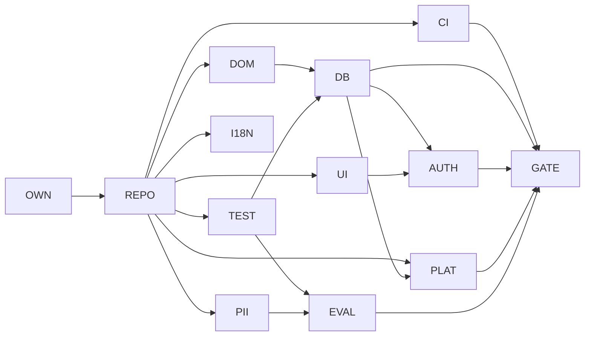
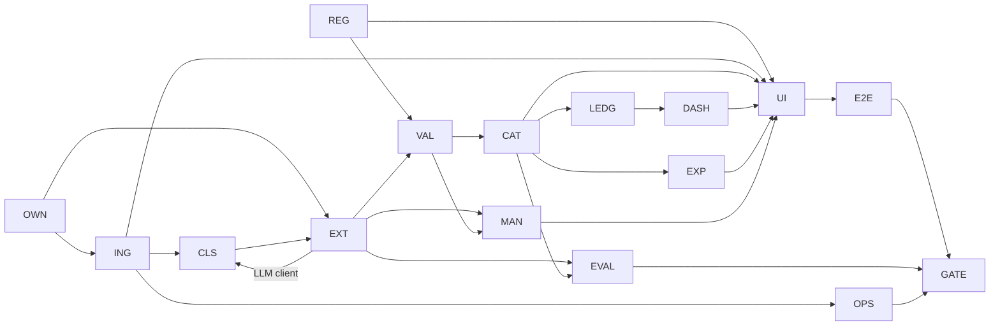
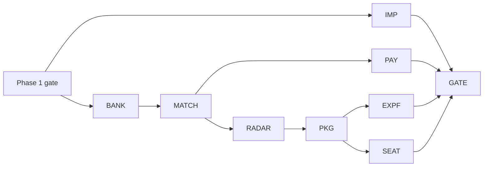
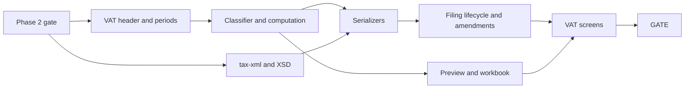
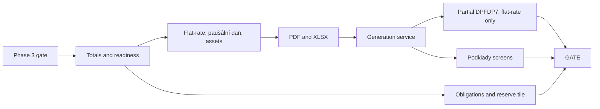

# Backlog: Shoebox V3

Ordered epics and tickets for Phases 0–4. Shoebox is a Czech document organizer plus accountant hand-off for OSVČ, **not accounting software**: every ticket keeps the app simple, lightweight and low-maintenance.

## How to read this backlog

- **Who uses it.** The orchestrator (Opus 5.5 or Fable 5.1) takes the next ticket whose `Depends on` tickets are all done and whose phase is open (02: a phase opens only after the previous GATE ticket passes). It turns the ticket into 1–N briefs in `docs/tasks/` using `docs/tasks/TEMPLATE.md`. A ticket is done when all its briefs are `done` and every Acceptance box is ticked in the last report.
- **Brief budget.** One brief = one Haiku 5.5 session: 30 tool calls, about 60k tokens, one PR of at most ~600 changed lines. New-file briefs carry the full test file as the spec (workflow "Writing briefs for the executor").
- **Ids.** `P<phase>-<EPIC>-<nn>`, e.g. `P0-DOM-01`. Ids are stable; a split ticket becomes `P1-EXT-03a`/`b`, never renumbered. "Later" items have no ids yet.
- **Spec references** name the file and the heading text, e.g. "M02 §4.7 Merge, provenance and confidence". Section numbers can shift while the specs are reviewed; search the heading text. 02–07 are the numbered docs in `docs/v3/`; M01–M12 are in `docs/v3/modules/`.
- **Size.** S = 1 brief · M = 2–3 briefs · L = 4–6 briefs. Nothing is larger; split it instead.
- **Executor.** Haiku 5.5 by default. `Sonnet 5.5` appears only with one of the three reasons from workflow "Choosing the executor" (eval tuning, visual judgement, second attempt), and only on the brief that needs it. `Owner` tickets are clicks, accounts, secrets or decisions for Josef; the orchestrator writes numbered steps for him.
- **Orchestrator model.** Fable 5.1 writes the briefs for every `Risk: HIGH` ticket and for P0-REPO-01, P0-REPO-02, P0-PII-02, P0-EVAL-02 and every GATE ticket; Opus 5.5 writes the rest and does all reviews. In a phase run, Opus runs the phase and hands those Fable briefs to a Fable subagent (workflow "Phase run").
- **Risk.** **HIGH** = money or VAT math, tax XML (EPO and accounting XML), migrations or RLS, auth, deletion, anything that sends (e-mail, share links). HIGH briefs give exact code or exact tests, and the reviewer reads the full diff of the risk-list files. Everything else is `normal`.
- **Acceptance** items are checked by the command or test named on the line, run per `docs/context/test-map.md` with `2>&1 | tail -30`. Test files live in `packages/<pkg>/test/` (unit, property), `packages/db/test/` (migrations, RLS), `apps/web/e2e/` (Playwright, axe on). UI tickets also copy the 07 §9 Pre-delivery checklist into the brief's §7.
- **Standing rules for every ticket** (AGENTS.md hard rules): money is `Money`, never `number`; law numbers only in `packages/domain/rules` with a source link and a test on a known date plus the day before a change; the schema is one DDL in 05: Phase 0 migrates every table except the 05 §9.1 Later tables, and a later schema change is a new migration plus a 05 edit with RLS policies, a testkit factory and an RLS case in the same PR; job and event names are the canonical list in 03 §3.1; rule keys are the list in 06 §2; a new dependency needs an owner line in `docs/context/decisions.md` (the OWN tickets collect them); a `[verify]` is checked against the primary source and recorded in the report; an open question uses its 22 default and the ticket names its id (D-, TA-, T-, L-), with `TODO(decision-XX)` in code.
- **Golden set.** `testdata/golden-v1/` is committed (20 arrivals, `labels.json`, anonymized and verified on 2026-10-18). P0-EVAL-03 is done.

---

## Phase 0: Foundations

Exit criteria: 02 Phase 0: Foundations (Exit criteria). Specs: 03, 05, M12.

### Epic OWN: owner decisions (Phase 0)

### P0-OWN-01: Dependency and tooling decisions for Phase 0
Spec: AGENTS.md rule 7 · 03 ADR-010 Monorepo layout · M12 §4.1 Monorepo and tooling | Depends on: none | Size: S | Executor: Owner | Risk: normal
Goal: record owner approval for every Phase 0 dependency so executors never stop on rule 7.
Acceptance:
- [x] `docs/context/decisions.md` has one line each for: pnpm 10 + Corepack, Turborepo, Biome 2, Vitest, fast-check, Playwright + @axe-core/playwright, dependency-cruiser, Renovate, gitleaks, decimal.js, zod, @supabase/ssr + Supabase CLI, Tailwind 4, Inter via next/font, pino, Sentry SDK (EU), OpenTelemetry SDK, ts-morph (lint fallback).
- [x] Decision line for the extra package `packages/platform` named in M12 §6 Interfaces (not in 03 ADR-010).
- [x] `python3 scripts/context_lint.py` passes.
Packages/files: docs/context/decisions.md

### Epic REPO: monorepo and tooling

### P0-REPO-01: Monorepo scaffold (pnpm, Turborepo, strict TS, Biome, Vitest)
Spec: M12 §4.1 Monorepo and tooling (root files table) · 03 ADR-010 Monorepo layout · M12 §4.13 Secrets | Depends on: P0-OWN-01 | Size: M | Executor: Haiku 5.5 | Risk: normal
Goal: a fresh clone installs, typechecks, lints and tests every empty package with one command.
Acceptance:
- [ ] `pnpm install --frozen-lockfile && pnpm typecheck && pnpm lint && pnpm test` passes on Node 22 (M12 §9 AC-1 first half).
- [ ] Root files match the M12 §4.1 table: `package.json` (pinned `packageManager`, `engines.node >=22 <23`, root scripts), `pnpm-workspace.yaml` (`onlyBuiltDependencies`), `.npmrc`, `turbo.json`, `tsconfig.base.json` (all listed strict flags), `biome.json`, `vitest.workspace.ts` (projects unit, db, ui), `renovate.json` (verbatim from M12 §4.1).
- [ ] Every app and package of ADR-010 (+ `packages/platform`) exists as `@shoebox/<name>` with `exports` and a passing `test/smoke.test.ts`.
- [ ] `.env.example` lists the secret names of M12 §4.13 with no values.
Packages/files: package.json, pnpm-workspace.yaml, .npmrc, turbo.json, tsconfig.base.json, biome.json, vitest.workspace.ts, renovate.json, .env.example, apps/*/package.json, packages/*/package.json

### P0-REPO-02: Architecture and custom lint rules
Spec: M12 §4.1 Monorepo and tooling (Custom lint rules, dependency-cruiser rules) · M12 §9 AC-4, AC-5 · 22 T-17 | Depends on: P0-REPO-01, P0-CI-01 | Size: M | Executor: Haiku 5.5 | Risk: normal
Goal: CI rejects impure domain code, deep imports, JSX literal text, `Date.now()` in domain, number parsing of money and raw SQL outside `packages/db`.
Acceptance:
- [ ] `.dependency-cruiser.cjs` with domain-is-pure, no-cross-internals, apps-are-leaves, ui-no-server, no-circular; `pnpm depcruise` passes; `scripts/lint/test/depcruise.test.ts` proves a fixture importing `packages/db` or `node:fs` from domain fails (AC-4).
- [ ] Rules no-jsx-literal-text, no-date-now-in-domain, no-number-money (`parseFloat`/`Number()` in domain, tax-xml, exports), no-raw-sql-outside-db, no-dangerouslySetInnerHTML; report records the T-17 result (GritQL, else ts-morph default).
- [ ] `scripts/lint/test/custom-rules.test.ts`: JSX "Uložit" fails, `t('doc.confirm')` passes (AC-5); each other rule has one failing and one passing fixture.
- [ ] `ci.yml` gains the `depcruise` job and runs the rules inside `lint`.
Packages/files: .dependency-cruiser.cjs, tools/biome-plugins/ or scripts/lint/, .github/workflows/ci.yml

### Epic CI: continuous integration and deploys

### P0-CI-01: CI base workflow and context-lint job
Spec: M12 §4.3 CI/CD (GitHub Actions) steps 1–2 · AGENTS.md "Test" · docs/context/README.md | Depends on: P0-REPO-01 | Size: S | Executor: Haiku 5.5 | Risk: normal
Goal: every PR runs install, lint, typecheck, unit tests with coverage gates and the agent-context lint.
Acceptance:
- [ ] `.github/workflows/ci.yml` jobs `setup`, `lint`, `typecheck`, `unit`, `context-lint` (`python3 scripts/context_lint.py`); action versions pinned by digest.
- [ ] Coverage thresholds configured: `packages/domain` ≥ 90 %, `packages/validation` ≥ 90 %, `packages/tax-xml` ≥ 85 % lines.
- [ ] A PR run is green; a test PR with a broken link in `docs/context/` fails `context-lint` (screenshot or run link in the report).
Packages/files: .github/workflows/ci.yml, vitest.workspace.ts

### P0-CI-02: CI database job and migration lint
Spec: M12 §4.3 CI/CD (GitHub Actions) steps 3–4 · rules.md "Database" | Depends on: P0-DB-01, P0-CI-01 | Size: S | Executor: Haiku 5.5 | Risk: HIGH (migrations)
Goal: every PR migrates an ephemeral Supabase from scratch, runs the DB suite and refuses destructive migrations.
Acceptance:
- [ ] Job `db`: `supabase start` → migrations from scratch → `pnpm test:db` → `supabase db diff` empty.
- [ ] `scripts/migration-lint.ts` + `scripts/test/migration-lint.test.ts`: `drop table|drop column|alter column … type|rename` without a `-- contract: <ticket>` header fails; an additive migration passes.
- [ ] Job `migration-lint` runs on files changed under `packages/db/migrations/`.
Packages/files: .github/workflows/ci.yml, scripts/migration-lint.ts

### P0-CI-03: Build, E2E and eval jobs
Spec: M12 §4.3 CI/CD (GitHub Actions) steps 5–7 · M12 §8 edge case 10 (golden set not yet delivered) · M11 §10 Performance budgets | Depends on: P0-UI-03, P0-EVAL-02 | Size: S | Executor: Haiku 5.5 | Risk: normal
Goal: CI builds everything, runs Playwright with axe against the local stack and posts the eval report on the PR.
Acceptance:
- [ ] Jobs `build` (`turbo build`, `pnpm check:bundle` stub that reads the Next build manifest), `e2e` (Playwright, 3 projects, 0 skipped), `eval` (`pnpm eval --quick`, sticky PR comment with `eval-report.md`).
- [ ] `eval` is `continue-on-error` until `testdata/golden-v1/labels.json` exists, then mandatory (condition in the workflow, documented in the report).
Packages/files: .github/workflows/ci.yml, scripts/check-bundle-budget.ts

### P0-CI-04: Deploy pipeline (staging, production, PR previews)
Spec: M12 §4.2 Environments · M12 §4.3 CI/CD (GitHub Actions) `deploy.yml` · M12 §4.13 Secrets | Depends on: P0-CI-03, P0-PLAT-04, P0-AUTH-03 | Size: M | Executor: Haiku 5.5 + Owner | Risk: HIGH (migrations in production)
Goal: a merge to `main` deploys staging automatically and production after one owner approval, migrations first, with one-command rollback.
Acceptance:
- [ ] `deploy.yml`: images built once (distroless Node 22), Artifact Registry `europe-west1`, Workload Identity Federation (no JSON keys), staging migrate → worker → web → `@smoke` Playwright, production behind GitHub Environment `production`.
- [ ] Preview job deploys a `--no-traffic` tagged revision for PRs without migrations and comments the URL (D-09: no Supabase Branching).
- [ ] `docs/runbooks/deploy-rollback.md` with the rollback command.
- [ ] Owner steps done (projects `shoebox-staging`/`shoebox-prod` in eu-central-1, GCP project, Secret Manager entries, log bucket in `europe-west1`, Sentry EU project); first staging deploy is green.
Packages/files: .github/workflows/deploy.yml, apps/web/Dockerfile, apps/worker/Dockerfile, docs/runbooks/deploy-rollback.md

### Epic PII: personal-data guard

### P0-PII-01: Secret scanning with gitleaks
Spec: M12 §4.3 CI/CD (GitHub Actions) step 2 (`secrets`) · M12 §4.13 Secrets · rules.md "Privacy and security" | Depends on: P0-CI-01 | Size: S | Executor: Haiku 5.5 | Risk: normal
Goal: no key, token or `.env` reaches the repository.
Acceptance:
- [ ] CI job `secrets` runs gitleaks on the PR diff with `.gitleaks.toml`; a PR adding a fake Supabase service key fails.
- [ ] Optional local hook documented in the report (`gitleaks protect --staged`).
Packages/files: .gitleaks.toml, .github/workflows/ci.yml

### P0-PII-02: Czech PII rules (account numbers, rodná čísla, IBAN, DIČ from birth number)
Spec: AGENTS.md rule 4 · rules.md "Privacy and security" · M12 §4.6 Privacy and GDPR (Rodné číslo (RČ) policy) · M02 §4.4.4 Regex extractors (checksums) · M03 §4.2 Shared helpers (`dicFormat`) | Depends on: P0-PII-01 | Size: M | Executor: Haiku 5.5 | Risk: normal
Goal: CI blocks real-looking Czech personal identifiers anywhere except allowlisted public or synthetic values in test data.
Acceptance:
- [ ] `scripts/pii_guard.py` (stdlib only) scans added lines of the diff, or a path with `--all`; matches are validated by checksum (RČ mod 11 + plausible date, CZ account mod 11 with weights `6,3,7,9,10,5,8,4,2,1` and a known bank code, IBAN mod 97, `CZ` + 9–10 digits that pass the RČ check) to keep false positives low.
- [ ] `scripts/test/test_pii_guard.py`: each identifier type fails in `apps/`, `packages/*/src` and `testdata/`; an 8-digit company DIČ (`CZ` + IČO) passes; a checksum-invalid digit string passes.
- [ ] `testdata/pii-allowlist.txt` (`value;reason;source`) admits public company IDs (e.g. supplier DIČ printed on golden invoices) and the synthetic test RČ of M06 §9 only under `testdata/` and `packages/*/test|fixtures/`.
- [ ] CI job `pii` fails the PR on a hit; the same patterns are added to `.gitleaks.toml` for history scans.
Packages/files: scripts/pii_guard.py, scripts/test/test_pii_guard.py, testdata/pii-allowlist.txt, .gitleaks.toml, .github/workflows/ci.yml
Note: no spec section defines these rules; the ticket text is the spec until M12 gains one.

### Epic DOM: pure domain (Money, dates, rules)

### P0-DOM-01: Money value object
Spec: 03 ADR-007 Money, rounding and dates · rules.md "Money and tax" · M12 §4.1 (no-number-money) | Depends on: P0-REPO-01 | Size: S | Executor: Haiku 5.5 | Risk: HIGH (money)
Goal: one branded `Money` type (decimal.js, 28 digits, ROUND_HALF_UP, currency) that makes float arithmetic on money impossible.
Acceptance:
- [ ] `packages/domain/test/money.test.ts` (fast-check): add/subtract associativity and commutativity, `parse('1234.56')`, `toFixed2()`, currency mismatch throws, no `number` accepted (`// @ts-expect-error` cases compile).
- [ ] `pnpm --filter @shoebox/domain test -- money` green; coverage ≥ 90 %.
Packages/files: packages/domain/src/money.ts

### P0-DOM-02: Named rounding functions
Spec: 03 ADR-007 Money, rounding and dates (rounding rules) · M05 §8 edge case 13 · M06 §4 Detailed behavior (round0, floor100) | Depends on: P0-DOM-01 | Size: S | Executor: Haiku 5.5 | Risk: HIGH (money)
Goal: every rounding context is a named pure function in `rounding.ts`, never inline.
Acceptance:
- [ ] `packages/domain/test/rounding.test.ts`: `vatForRate = round2(base × rate)`; `round0(2425.50) = 2426` (half away from zero); `floor100` for the DPFO base; `roundingLineAllowed(diff) ⇔ |diff| ≤ 1.00 CZK`; cash rounding to whole CZK.
- [ ] Property: `|round2(x) − x| ≤ 0.005` for random decimals.
Packages/files: packages/domain/src/rounding.ts

### P0-DOM-03: Canonical enums, legal dates and the clock
Spec: 04 (all enums) · 05 §1 Enums · 03 ADR-007 (legal dates, "today" in Europe/Prague) · M12 §4.1 (no-date-now-in-domain) | Depends on: P0-REPO-01 | Size: S | Executor: Haiku 5.5 | Risk: normal
Goal: TypeScript unions identical to the 05 enums plus a `LegalDate` type and an injected `Clock`.
Acceptance:
- [ ] `packages/domain/src/enums.ts` has every 05 §1 enum; `packages/domain/test/enums.test.ts` compares each union with the 05 value list.
- [ ] `packages/domain/test/dates.test.ts`: `pragueToday(clock)` at `2026-10-18T22:30Z` is `2026-10-19`; DST change days; `LegalDate` parse/compare/addDays.
Packages/files: packages/domain/src/enums.ts, packages/domain/src/dates.ts, packages/domain/src/clock.ts

### P0-DOM-04: RuleSet schema and the effective-dated resolver `rules.at(date)`
Spec: 06 §2 Rule tables: how law lives in data · 03 ADR-008 Law as versioned data · M12 §4.9 (rules_overrides editor, zod per key) | Depends on: P0-DOM-01, P0-DOM-03 | Size: M | Executor: Haiku 5.5 | Risk: HIGH (tax rules)
Goal: a pure resolver that merges base-year data, mid-year amendments and `rules_overrides` rows for any date.
Acceptance:
- [ ] Zod `RuleSet` with one schema per rule key; every value carries `valid_from`, `valid_to`, `source` URL and `verified_at` (missing source is rejected).
- [ ] `packages/domain/test/rules-engine.test.ts`: segment selection on boundaries, amendment beats base, overrides (passed in as data) apply last, a date without data throws `RuleMissingError`, resolver is pure (no I/O imports).
- [ ] `getRuleKeySchema(key)` exported for the admin editor.
Packages/files: packages/domain/rules/schema.ts, packages/domain/rules/index.ts

### P0-DOM-05: Seed rule tables 2025–2026
Spec: 06 §2 Rule tables (rule keys V3) · 02 Phase 0: Foundations (Exit criteria) · 04 §7 Limits, meters, alerts and deadlines | Depends on: P0-DOM-04 | Size: M | Executor: Haiku 5.5 | Risk: HIGH (tax rules)
Goal: the law values every Phase 1 module needs, each with source, date and tests.
Acceptance:
- [ ] `packages/domain/rules/cz/2025.ts` and `2026.ts` with `vat.rates`, `vat.registration_thresholds`, `vat.kh_document_limit`, `vat.simplified_document_limit`, `vat.io_eu_goods_threshold`, `vat.deduction_deferral_years`, `vat.ruceni_cash_threshold`, `vat.cnb_rate_rule`, `vat.deadline_day`, `pausalni_vydaje.rates_caps`, `pausalni_dan.bands|eligibility|deadlines`, `insurance.min_advances`, `asset.capitalization_threshold`, `cash.payment_limit` (EUR 10 000 from 2027-07-10).
- [ ] `packages/domain/test/rules/values.test.ts`: every key asserts its value on a known date and the previous value the day before a change (06 §2); `rules.at('2026-05-01').pausalni_dan.bands[0].monthly = 9162` (02 Phase 0 exit).
- [ ] Each value's `source` is a primary source; [verify] results against `research/czech-tax-filings.md` [O] lines in the report.
Packages/files: packages/domain/rules/cz/2025.ts, packages/domain/rules/cz/2026.ts

### Epic DB: schema in migration slices with RLS

### P0-DB-01: packages/db scaffold, enums and tenancy tables
Spec: 05 §1 Enums · 05 §2 Tenancy and profile · 05 §10.1 Pattern · 03 ADR-002 PostgreSQL (Supabase) | Depends on: P0-DOM-03, P0-REPO-01 | Size: M | Executor: Haiku 5.5 | Risk: HIGH (migrations, RLS)
Goal: Drizzle + Supabase CLI set up, with the enums, `organizations`, `memberships`, `taxpayer_profiles`, `app.user_org_ids()`, `app.user_has_role()` and the `app.apply_tenant_rls` helper migrated.
Acceptance:
- [ ] `supabase/config.toml`, `packages/db/drizzle.config.ts`, migrations `packages/db/migrations/0001_enums.sql`, `0002_tenancy.sql`; root scripts `db:start`, `db:reset`, `test:db`.
- [ ] `packages/db/test/migrations/tenancy.test.ts`: from-scratch migrate; overlapping profile segments rejected by the exclusion constraint; RLS enabled with select/write policies per 05 §10.1 Pattern; owner-only writes per 05 §10.2.
- [ ] `packages/db/test/enums-parity.test.ts`: Postgres enum values equal `packages/domain/src/enums.ts`.
Packages/files: supabase/config.toml, packages/db/drizzle.config.ts, packages/db/migrations/, packages/db/src/schema/tenancy.ts

### P0-DB-02: `withTenant`, `withServiceRole` and the `app_worker` role
Spec: 05 §10.1 Pattern (worker role) · M12 §4.4 Auth, roles and RLS testing (Worker isolation) · M12 §6 Interfaces (packages/db) | Depends on: P0-DB-01 | Size: M | Executor: Haiku 5.5 | Risk: HIGH (RLS)
Goal: the worker can only see the org it set for the current transaction.
Acceptance:
- [ ] Migration creates `app_worker` (nobypassrls) and the helper that adds the `<t>_worker` policy to every table with `org_id`.
- [ ] `withTenant(orgId, fn)` sets `app.org_id` local to the transaction; `withServiceRole(reason, fn)` only for `retention|export|admin|migration`.
- [ ] `packages/db/test/with-tenant.test.ts`: as `app_worker` without `app.org_id` → 0 rows; with org A → only A rows; setting does not leak after commit.
Packages/files: packages/db/src/tenant.ts, packages/db/migrations/0003_app_worker.sql

### P0-DB-03: RLS test suite and static tenant check
Spec: M12 §4.4 Auth, roles and RLS testing (RLS test suite items 1–4, 6) · M12 §9 AC-2, AC-3 | Depends on: P0-DB-02, P0-TEST-01 | Size: M | Executor: Haiku 5.5 | Risk: HIGH (RLS)
Goal: a catalog-driven suite that fails CI when any tenant table lacks RLS, policies, a worker policy or a factory.
Acceptance:
- [ ] `packages/db/test/rls/meta.test.ts` (catalog check + allowlist of global tables), `isolation.test.ts` (org A × B for every table and role), `roles.test.ts` (viewer read-only; accountant writes only comments, review answers, accountant_packages; member cannot write memberships/profiles/organizations), `worker.test.ts`.
- [ ] A deliberately broken fixture migration (table with `org_id`, no RLS) makes `meta.test.ts` fail (AC-2); a missing factory fails `isolation.test.ts`.
- [ ] `pnpm check:tenant-sql` (TypeScript compiler API, T-17) flags a Drizzle call on a tenant table outside `withTenant` in a fixture file.
Packages/files: packages/db/test/rls/, scripts/check-tenant-sql.ts

### P0-DB-04: Migration slice: partners, registries and classification support
Spec: 05 §3 Partners and registries · 05 §5 Classification support · 05 §10.3 Global tables | Depends on: P0-DB-03 | Size: M | Executor: Haiku 5.5 | Risk: HIGH (migrations, RLS)
Goal: `partners`, `partner_bank_accounts`, `registry_cache`, `fx_rates`, `bank_codes`, `categories`, `vendor_profiles` with RLS and factories.
Acceptance:
- [ ] One migration per 05 section; global tables (`registry_cache`, `fx_rates`, `bank_codes`, `categories`) are in the meta-test allowlist with the grants of 05 §10.3.
- [ ] `pnpm --filter @shoebox/db test -- migrations rls` green including the new tables.
- [ ] `global_vendor_priors` is not migrated (05 §9.1 Later).
Packages/files: packages/db/migrations/, packages/db/src/schema/, packages/testkit/src/factories/

### P0-DB-05: Migration slice: ingestion and document core
Spec: 05 §4 Ingestion and documents (`inbound_emails`, `source_files`, `documents`, `document_revisions`, `ingest_items`, `expected_documents`) · 05 §10.2 Exceptions to the default | Depends on: P0-DB-03 | Size: M | Executor: Haiku 5.5 | Risk: HIGH (migrations, RLS)
Goal: the ingestion tables with their indexes (incl. `documents_semantic_dedupe`, register and search indexes), RLS and factories.
Acceptance:
- [ ] `packages/db/test/migrations/documents-core.test.ts`: semantic dedupe unique index rejects a second active row with the same key; `entry_mode` check (only `captured` requires `source_file_id`); `documents.status` accepts `supporting`, not `rejected`.
- [ ] `ingest_items` is select-only for users (05 §10.2); RLS suite green for the six tables.
Packages/files: packages/db/migrations/, packages/db/src/schema/documents.ts, packages/testkit/src/factories/

### P0-DB-06: Migration slice: document detail tables
Spec: 05 §4 Ingestion and documents (`document_links`, `document_lines`, `document_vat_summary`, `document_fields`, `extraction_runs`, `validation_results`, `review_questions`) · 05 §10.2 Exceptions to the default | Depends on: P0-DB-05 | Size: M | Executor: Haiku 5.5 | Risk: HIGH (migrations, RLS)
Goal: lines, provenance, runs, validation results and questions with RLS, including the accountant's column-level write on `review_questions`.
Acceptance:
- [ ] `roles.test.ts` case: accountant may update only `answer`, `answered_by`, `answered_at` on `review_questions`; `extraction_runs` select-only for users.
- [ ] RLS suite green for the seven tables.
Packages/files: packages/db/migrations/, packages/db/src/schema/, packages/testkit/src/factories/

### P0-DB-07: Migration slice: platform tables
Spec: 05 §9 Platform · 05 §10.3 Global tables | Depends on: P0-DB-03 | Size: M | Executor: Haiku 5.5 | Risk: HIGH (migrations, RLS)
Goal: `audit_log`, `rules_overrides`, `llm_usage_daily`, `staff_users`, `privacy_requests`, `rate_limit_counters` and `app.rate_limit_hit()`.
Acceptance:
- [ ] `packages/db/test/rate-limit.test.ts`: 3rd hit with max 2 in one window returns false; a new window resets.
- [ ] `staff_users`, `rules_overrides`, `rate_limit_counters` service-role only; `privacy_requests` owner-only (RLS cases); `rateLimitHit(key, max, windowS)` exported from `packages/db`.
- [ ] The 05 §9.1 Later tables (`extraction_batches`, `support_access_grants`, …) are not migrated.
Packages/files: packages/db/migrations/, packages/db/src/schema/platform.ts, packages/db/src/rate-limit.ts

### P0-DB-08: Migration slice: money and bank
Spec: 05 §6 Money (Phase 2 features; tables exist from Phase 0) | Depends on: P0-DB-06 | Size: M | Executor: Haiku 5.5 | Risk: HIGH (migrations, RLS)
Goal: `money_accounts`, `import_mappings`, `spreadsheet_imports`, `statement_imports`, `transactions`, `payment_links`, `match_suggestions`, `counterparty_aliases`, `payment_orders`, `payment_order_items` with RLS and factories, so Phase 2 needs no new tables.
Acceptance:
- [ ] `statement_imports` and `match_suggestions` select-only for users (05 §10.2); accountant cannot write `payment_links`.
- [ ] RLS suite green for the ten tables; `bank_connections` not migrated (05 §9.1).
Packages/files: packages/db/migrations/, packages/db/src/schema/money.ts, packages/testkit/src/factories/

### P0-DB-09: Migration slice: ledgers and outputs
Spec: 05 §7 Ledgers · 05 §8 Outputs · 05 §10.2 Exceptions to the default | Depends on: P0-DB-08 | Size: M | Executor: Haiku 5.5 | Risk: HIGH (migrations, RLS)
Goal: `tax_ledger_entries`, `vat_ledger_entries`, `filings`, `filing_documents`, `filing_entries`, `export_profiles`, `export_mappings`, `accountant_packages`, `accountant_package_items`, `package_shares`, `comments`, `obligations`, `notifications` with the 05 §10.2 exceptions.
Acceptance:
- [ ] Derived tables select-only for users; `obligations` users may update only `state`, `done_at`, `done_source`; accountant may move `accountant_packages` only `sent → acknowledged`; `filings` one-open-per-kind unique index.
- [ ] RLS suite green; every 05 table except §9.1 now has an RLS case (02 Phase 0 exit).
Packages/files: packages/db/migrations/, packages/db/src/schema/, packages/testkit/src/factories/

### P0-DB-10: Storage bucket, storage policies and BlobStore
Spec: 03 ADR-004 Object storage on Supabase Storage (layout, lifecycle) · M12 §4.4 Auth, roles and RLS testing (RLS test suite item 5) · M12 §4.5 Security (V4.2 signed URLs) | Depends on: P0-DB-03 | Size: S | Executor: Haiku 5.5 | Risk: HIGH (RLS)
Goal: bucket `org-files` with `org/{org_id}/` prefix policies and a `BlobStore` interface (put, get, presignPut, signedUrl, delete) that hides Supabase.
Acceptance:
- [ ] `packages/db/test/rls/storage.test.ts`: user of A cannot sign a URL for B's object; upload outside own prefix fails.
- [ ] `packages/platform/test/blob-store.test.ts`: content-addressed path helper `org/{org}/files/{sha256}`; signed URL TTL 300 s.
Packages/files: packages/db/migrations/, packages/platform/src/blob-store.ts

### P0-DB-11: Seeds: category taxonomy and persona demo orgs
Spec: 04 §3.1 Categories (`category_code`): seed taxonomy · 02 Phase 0: Foundations (Exit criteria) · M12 §4.2 Environments (local) · M06 §9 Acceptance criteria and test plan (persona profiles S1–S4) | Depends on: P0-DB-09 | Size: M | Executor: Haiku 5.5 | Risk: normal
Goal: `pnpm db:reset` seeds every category and four demo orgs (P1–P4); `pnpm dev` starts Supabase, web and worker with them.
Acceptance:
- [ ] `packages/db/seeds/categories.ts`: every `category_code` of 04 §3.1 with `tax_effect`, cs/en label, Lucide icon and explanation; `packages/db/test/seeds.test.ts` compares with the 04 list.
- [ ] Personas: P1 paušální daň band 1; P2 neplátce, daňová evidence; P3 plátce quarterly, paušální výdaje 60 %; P4 identifikovaná osoba monthly, daňová evidence, `foreign_service_dppd_policy='issue_date'` (D-05 default otherwise); one owner login each.
- [ ] `pnpm dev` starts everything; the report shows the four orgs listed.
Packages/files: packages/db/seeds/, package.json (dev script)

### Epic I18N: messages

### P0-I18N-01: i18n package with Czech source catalog
Spec: M11 §12 i18n conventions · 03 §4 Non-functional requirements (Localization) | Depends on: P0-REPO-01 | Size: S | Executor: Haiku 5.5 | Risk: normal
Goal: ICU catalogs `cs` (source) and `en`, a typed `t()` and a CI check for missing keys.
Acceptance:
- [ ] `packages/i18n/messages/cs.json`, `en.json`; `t(key, params)` server and client.
- [ ] `pnpm --filter @shoebox/i18n test`: `en` has every `cs` key; invalid ICU fails; Czech plurals render "1 doklad", "2 doklady", "5 dokladů".
- [ ] `pnpm check:i18n` wired into `lint`.
Packages/files: packages/i18n/

### Epic UI: design system and app shell

### P0-UI-01: Design tokens, Tailwind theme and Inter
Spec: 07 §3 Color tokens · 07 §4 Typography · 07 §5 Space, layout, shape | Depends on: P0-REPO-01 | Size: S | Executor: Haiku 5.5 | Risk: normal
Goal: `tokens.css` is the only place raw colors exist, mapped into the Tailwind 4 theme, with self-hosted Inter (latin + latin-ext).
Acceptance:
- [ ] `packages/ui/src/tokens.css` equals 07 §3 for light and dark, including the `prefers-color-scheme` block; `packages/ui/test/tokens.test.ts` parses it against the 07 table.
- [ ] `packages/ui/test/no-raw-colors.test.ts` fails on any hex outside `tokens.css` in `apps/web` and `packages/ui`.
- [ ] Type scale and 4 px spacing exported as theme values; tabular numerals utility.
Packages/files: packages/ui/src/tokens.css, packages/ui/src/theme.css, packages/ui/src/fonts.ts

### P0-UI-02: shadcn base primitives and status components
Spec: 07 §6 Components (packages/ui) · M11 §8 Component inventory (MoneyText, LegalDateText, StatusBadge) · M11 §4 Document status → user-facing status · 07 §8 Accessibility | Depends on: P0-UI-01, P0-I18N-01 | Size: M | Executor: Haiku 5.5 | Risk: normal
Goal: vendored shadcn/Radix primitives, Lucide, Sonner, plus `StatusBadge`, `MoneyText`, `LegalDateText`, each with a Vitest + axe test.
Acceptance:
- [ ] Primitives in `packages/ui/src/primitives` (Button, Input, Label, Select, RadioGroup, Checkbox, Switch, Tabs, Card, Badge, Alert, Dialog, Sheet, Table, Toast).
- [ ] `packages/ui/test/status-badge.test.tsx`: every row of M11 §4 renders icon + word + tone; `money-text.test.tsx`: `1 234,56 Kč` with NBSP and tabular numerals; `legal-date.test.tsx`: `18. 10. 2026`.
- [ ] `pnpm --filter @shoebox/ui test:a11y` reports 0 axe violations in light and dark.
Packages/files: packages/ui/src/primitives/, packages/ui/src/components/

### P0-UI-03: Web app shell with four screens and Playwright + axe
Spec: 07 §5 Space, layout, shape (App shell) · 07 §8 Accessibility · M11 §3 Information architecture · M12 §4.1 (playwright.config.ts) | Depends on: P0-UI-02 | Size: M | Executor: Haiku 5.5 | Risk: normal
Goal: Next.js 15 shell with left rail (desktop) and bottom bar with "+" (mobile) for Inbox, Přehled, Pro účetní, Nastavení, all strings through i18n.
Acceptance:
- [ ] `playwright.config.ts` with projects `desktop-chromium`, `mobile-webkit`, `mobile-chromium` and an auto-run axe fixture.
- [ ] `apps/web/e2e/shell.spec.ts`: 4 nav items; skip link "Přeskočit na obsah"; landmarks; theme switch light/dark/system; no horizontal scroll at 320 and 375 px; no request to Google font hosts; axe 0 violations.
Packages/files: apps/web/app/, playwright.config.ts, apps/web/e2e/shell.spec.ts

### Epic AUTH: authentication and organizations

### P0-AUTH-01: Supabase Auth with SSR sessions
Spec: 03 ADR-012 Auth and roles · M12 §4.4 Auth, roles and RLS testing (sessions) · M12 §4.5 Security (V2.1–2.5, V3.2–3.4) | Depends on: P0-UI-03, P0-DB-01 | Size: M | Executor: Haiku 5.5 | Risk: HIGH (auth)
Goal: magic link and password login with secure cookies, idle logout after 12 h and "logout everywhere".
Acceptance:
- [ ] `apps/web/e2e/auth.spec.ts`: magic link via local Supabase inbox logs in; cookies HttpOnly, Secure, SameSite=Lax; logout everywhere ends other sessions.
- [ ] Google and Apple providers configured but disabled until the owner adds credentials (owner steps).
- [ ] Report records the [verify] of password length 12 + leaked-password check in Supabase.
Packages/files: apps/web/lib/supabase/, apps/web/app/(auth)/, apps/web/middleware.ts

### P0-AUTH-02: Org context and role guard
Spec: M12 §4.4 Auth, roles and RLS testing (Role matrix) · 04 §1 Organization and taxpayer profile · M11 §3 Information architecture (org switcher) | Depends on: P0-AUTH-01, P0-DB-03 | Size: S | Executor: Haiku 5.5 | Risk: HIGH (auth)
Goal: every server action and route resolves the active org and checks the role matrix before RLS does.
Acceptance:
- [ ] `requireRole(orgId, roles)` returns typed `{ ok: false, code: 'forbidden' }`; active org from cookie with membership check; switcher shown only with > 1 membership.
- [ ] `apps/web/test/authz.test.ts`: one case per row and role of the M12 role matrix.
Packages/files: apps/web/lib/authz.ts, apps/web/lib/org-context.ts

### P0-AUTH-03: CSP, security headers and health endpoint
Spec: M12 §4.5 Security (CSP and headers) · M12 §9 AC-8 · M12 §4.2 Environments (health) | Depends on: P0-UI-03 | Size: S | Executor: Haiku 5.5 | Risk: HIGH (auth/security)
Goal: per-request nonce CSP, HSTS and the M12 header set on every page, plus `GET /api/health`.
Acceptance:
- [ ] `apps/web/e2e/headers.spec.ts`: `/inbox` carries CSP with nonce, HSTS, `frame-ancestors 'none'`, `Cache-Control: no-store`; no CSP violation during the shell flow.
- [ ] `/api/health` answers 200 with DB ping ≤ 200 ms locally.
Packages/files: apps/web/middleware.ts, apps/web/app/api/health/route.ts

### Epic PLAT: platform and observability baseline

### P0-PLAT-01: Structured logger with allowlist serializer
Spec: M12 §4.7 Observability (Logs) · M12 §9 AC-9 | Depends on: P0-REPO-01 | Size: S | Executor: Haiku 5.5 | Risk: normal
Goal: `pino` JSON logs with mandatory fields and an allowlist, so document content can never be logged.
Acceptance:
- [ ] `packages/platform/test/logger.test.ts`: logging an object with `partnerName`, `text`, `iban`, `amount` emits none of them; mandatory fields present.
Packages/files: packages/platform/src/logger.ts

### P0-PLAT-02: Sentry (EU) and OpenTelemetry baseline
Spec: M12 §4.7 Observability (Tracing, Errors, Metrics) · M12 §9 AC-9 | Depends on: P0-PLAT-01, P0-PLAT-04 | Size: M | Executor: Haiku 5.5 | Risk: normal
Goal: errors go to Sentry EU with a scrubber; traces go web → job → worker with `traceparent` in job metadata; metric instruments are registered.
Acceptance:
- [ ] `packages/platform/test/sentry-scrub.test.ts`: `beforeSend` redacts an RČ, an IBAN, a CZ account number and an e-mail in a message; `sendDefaultPii: false`.
- [ ] `packages/platform/test/telemetry.test.ts`: `startTelemetry('worker')` registers the M12 metric names; a job enqueued inside a span carries `traceparent` in metadata, not payload.
Packages/files: packages/platform/src/sentry.ts, packages/platform/src/telemetry.ts

### P0-PLAT-03: Signed webhooks
Spec: M12 §4.5 Security (Signed webhooks) · M12 §9 AC-6 | Depends on: P0-REPO-01 | Size: S | Executor: Haiku 5.5 | Risk: HIGH (auth)
Goal: `signWebhook`/`verifyWebhook` with timestamp window, constant-time compare and dual secrets during rotation.
Acceptance:
- [ ] `packages/platform/test/webhook.test.ts`: rejects missing header, timestamp 301 s old, tampered body, wrong secret; accepts the second secret; property `verify(sign(x)) = ok`.
Packages/files: packages/platform/src/webhook.ts

### P0-PLAT-04: Worker with pg-boss job registry
Spec: 03 ADR-003 Job queue in Postgres (pg-boss) · 03 §3 Pipeline (state machine per document) · M12 §4.2 Environments (worker settings, `/healthz`) | Depends on: P0-DB-02, P0-PLAT-01 | Size: M | Executor: Haiku 5.5 | Risk: normal
Goal: `apps/worker` starts pg-boss, registers jobs with zod payloads (ids only), idempotency keys `{org}:{stage}:{id}:{v}`, retries, dead-letter queues and Europe/Prague crons; every tenant job runs inside `withTenant`.
Acceptance:
- [ ] `apps/worker/test/registry.test.ts`: payload with a non-id field rejected; same key enqueued twice → one job; 5 failures → DLQ; handler receives a tenant transaction.
- [ ] `/healthz` reports pg-boss started and last cron tick < 2 min.
Packages/files: apps/worker/src/, packages/pipeline/src/jobs.ts

### Epic TEST: testkit and fakes

### P0-TEST-01: Testkit scaffold and factory registry
Spec: 03 ADR-010 (packages/testkit) · M12 §4.4 RLS test suite item 2 (factories) | Depends on: P0-REPO-01, P0-DOM-03 | Size: S | Executor: Haiku 5.5 | Risk: normal
Goal: a fake `Clock`, deterministic ids and a registry where every tenant table has one factory (the RLS suite iterates it).
Acceptance:
- [ ] `packages/testkit/test/factories.test.ts`: `factoryFor(table)` throws for an unknown table; fake clock advances deterministically.
Packages/files: packages/testkit/src/

### P0-TEST-02: Registry interfaces and fake registries
Spec: M03 §4.3 Registries and graceful degradation (clients, `RegistryResult`) · M12 §4.10 Evaluation harness (Runner step 2) · 06 §3 Drift monitors (recorded contracts) | Depends on: P0-TEST-01 | Size: S | Executor: Haiku 5.5 | Risk: normal
Goal: typed client interfaces for ARES, CRPDPH, VIES and ČNB in `packages/registries`, and fakes in testkit that replay recorded responses and can simulate outages.
Acceptance:
- [ ] `packages/testkit/test/fake-registries.test.ts`: known IČO returns the recorded subject; `simulate('unavailable')` returns `{status:'unavailable'}`; CRPDPH status codes 1/2/3 representable.
Packages/files: packages/registries/src/types.ts, packages/testkit/src/fakes/

### P0-TEST-03: LlmClient interface and cassette client
Spec: 03 ADR-011 LLM provider and data handling · M12 §4.10 Evaluation harness (Runner step 3 cassettes) · M12 §8 edge case 11 | Depends on: P0-TEST-01 | Size: M | Executor: Haiku 5.5 | Risk: normal
Goal: a provider-agnostic `LlmClient` (structured output, images, usage) with replay, record and live modes keyed by request hash.
Acceptance:
- [ ] `packages/testkit/test/cassette.test.ts`: hash independent of object key order; missing cassette fails with "missing cassette, run `pnpm eval --record`"; record writes `{model}/{prompt_version}/{sha256}.json`; replay makes no network call.
Packages/files: packages/extraction/src/llm/client.ts, packages/testkit/src/llm-cassette.ts

### Epic EVAL: evaluation harness

### P0-EVAL-01: Golden labels schema and loader
Spec: M12 §4.10 Evaluation harness (Golden-set loader, `GoldenLabels`) | Depends on: P0-TEST-01, P0-DOM-03 | Size: S | Executor: Haiku 5.5 | Risk: normal
Goal: `labels.json` is validated by the M12 zod schema, merged with `expected/*.json`, with an adapter hook instead of relaxing metrics.
Acceptance:
- [ ] `packages/testkit/test/labels.test.ts` on a synthetic 20-document stub (`packages/testkit/fixtures/golden-stub/`): valid stub loads; 19 documents fail; wrong money format fails; an adapter in `labels-adapters/v1.ts` is applied.
Packages/files: packages/testkit/src/eval/labels.ts, packages/testkit/src/eval/load.ts

### P0-EVAL-02: Eval runner, gates and `pnpm eval --quick`
Spec: M12 §4.10 Evaluation harness (Runner, Metrics and CI gates, Regression report) · M02 §4.12 Evaluation metrics | Depends on: P0-EVAL-01, P0-TEST-02, P0-TEST-03 | Size: M | Executor: Haiku 5.5 | Risk: normal
Goal: `runEval` with pluggable module adapters, every gate of the M12 table, baseline comparison and `eval-report.json/.md`.
Acceptance:
- [ ] `packages/testkit/test/eval-gates.test.ts`: each M12 gate row PASS/FAIL on synthetic reports; a check that passed in `baseline.json` and fails now is a regression; label `eval:baseline-change` documented.
- [ ] `pnpm eval --quick` runs offline in < 60 s on the stub and writes both reports; a FAIL row names document and field (format of M12 §4.10 Regression report).
- [ ] CLI flags `--module M01..M05`, `--record`, `--live`.
Packages/files: packages/testkit/src/eval/, scripts/eval.ts
Note: M12 leaves `apps/eval` vs `scripts/eval.ts` open; this ticket uses `scripts/eval.ts`.

### P0-EVAL-03: Commit the anonymized golden set (DONE 2026-10-18)
Spec: 00-README "Test data" · M12 §4.10 Evaluation harness · M02 §11 Q-6 (ISDOC/QR payloads anonymized consistently) | Depends on: P0-PII-02, P0-EVAL-01 | Size: S | Executor: Owner (+ Haiku 5.5 for the README) | Risk: normal
Goal: `testdata/golden-v1/` with 20 anonymized documents, `labels.json`, `expected/`, an empty `cassettes/` and a README saying the data is anonymized.
Acceptance:
- [ ] `pnpm eval --quick` loads it: 20 documents, 12 bookable, 6 decoys, 2 duplicates.
- [ ] `python3 scripts/pii_guard.py --all testdata/` passes with the allowlist; embedded ISDOC and QR payloads match the anonymized text.
Packages/files: testdata/golden-v1/

### P0-GATE-01: Phase 0 gate
Spec: 02 Phase 0: Foundations (Exit criteria) · M12 §9 AC-1–AC-6, AC-15 | Depends on: every P0 ticket | Size: S | Executor: Haiku 5.5 | Risk: normal
Goal: prove the foundations; the owner confirms in the PR.
Acceptance:
- [ ] Fresh clone: `pnpm install --frozen-lockfile && pnpm typecheck && pnpm lint && pnpm test` green on Node 22.
- [ ] `pnpm test:db`: RLS meta-test covers every `public` table (tenant tables + allowlist), isolation and role cases pass for every table (02).
- [ ] `pnpm dev` starts web, worker and Supabase with the P1–P4 orgs (02).
- [ ] `pnpm --filter @shoebox/domain test -- rules`: `rules.at('2026-05-01')` returns 2026 values incl. paušální daň band I = 9 162 Kč (02).
- [ ] `pnpm eval --quick` runs offline < 60 s (on golden-v1 if P0-EVAL-03 is done, else the stub; status.md records which).
- [ ] CI shows `secrets`, `pii`, `context-lint`, `depcruise`, `db`, `e2e` green; a test PR with a planted valid RČ is blocked by `pii`.
Packages/files: docs/context/status.md (orchestrator)

---
## Phase 1: MVP Scanner & Organizer

Exit criteria: 02 Phase 1: MVP, Scanner and Organizer (Exit criteria) and the M12 §4.10 gate table. Modules M01, M02, M03, M04, M09, M10 (Phase 1 part), M11.

### Epic OWN: owner decisions (Phases 1–2)

### P1-OWN-01: Dependency, vendor and policy decisions for Phases 1–2
Spec: AGENTS.md rule 7 · 22 D-07 (Amazon SES EU), D-08 (ClamAV on the worker), D-12 (exceljs), T-01, T-07, T-08 · 22 L-04 | Depends on: P0-GATE-01 | Size: S | Executor: Owner | Risk: normal
Goal: record owner lines for every library and vendor the pipeline needs before executors reach them.
Acceptance:
- [ ] Decision lines for: pdfjs-dist, @napi-rs/canvas, sharp + the HEIC path chosen under T-08 (default `heic-decode` WASM), zxing-wasm, fast-xml-parser, fflate, file-type, postal-mime, pdf-lib, exceljs (write and read, D-12), yazl, TanStack Table (approved by 07), Playwright Chromium in the worker image, react-pdf, the ClamAV sidecar on the worker only (D-08), the AWS SES SDK (D-07).
- [ ] Owner confirms D-07 (SES in `eu-central-1` as the 4th platform of 03 ADR-004b) and the Vertex AI EU region with Haiku 5.5 / Sonnet 5.5 (T-01, L-04).
- [ ] `python3 scripts/context_lint.py` passes.
Packages/files: docs/context/decisions.md

### Epic REG: registry clients

### P1-REG-01: ARES client, registry cache and ČNB daily data
Spec: M03 §4.3 Registries and graceful degradation (lookup policy) · M04 §4.9 FX · 05 §3 Partners and registries (`bank_codes`, `fx_rates`, `registry_cache`) · 06 §3 Drift monitors (Registry health) | Depends on: P0-TEST-02, P0-DB-04, P0-PLAT-04 | Size: M | Executor: Haiku 5.5 | Risk: normal
Goal: ARES subject lookup through `registry_cache` with TTL, timeout and stale-ok rules, plus nightly ČNB FX import and monthly bank-code refresh jobs.
Acceptance:
- [ ] `packages/registries/test/ares.test.ts` against recorded responses: found, not found, timeout → `unavailable` with cached data when younger than `registry.stale_ok_hours`.
- [ ] `packages/registries/test/cnb.test.ts`: daily fixing parsed into `fx_rates` (`amount` 100 for JPY/HUF); job is idempotent; emits `fx.rates_imported`.
- [ ] Bank-code CSV refresh writes `bank_codes` with `valid_from/valid_to`.
Packages/files: packages/registries/src/ares.ts, packages/registries/src/cnb.ts, apps/worker/src/jobs/registries/

### P1-REG-02: CRPDPH and VIES clients
Spec: M03 §4.3 Registries and graceful degradation · 22 §C T-04, T-05 | Depends on: P1-REG-01 | Size: M | Executor: Haiku 5.5 | Risk: normal
Goal: CRPDPH SOAP status (batches ≤ 100, published accounts) and VIES REST checks, both cached and never blocking.
Acceptance:
- [ ] `packages/registries/test/crpdph.test.ts`: status 1/2/3, unreliable flag, published accounts; 00:00–00:10 outage retried after 15 min.
- [ ] `packages/registries/test/vies.test.ts`: valid, invalid, `MS_UNAVAILABLE` as HTTP 200 + code → `unavailable`.
- [ ] Report records the T-04 endpoint and T-05 path [verify] results.
Packages/files: packages/registries/src/crpdph.ts, packages/registries/src/vies.ts

### Epic ING: ingestion channels, normalization, dedupe

### P1-ING-01: Pipeline config, ingest payload schemas and status transitions
Spec: M01 §6.2 Payload schemas · M01 §4.11 Pipeline state machine · 03 §3 Pipeline (state machine per document) · 03 §3.1 Job and event names (canonical) · 06 §2.2 Product keys ("Not rule tables") | Depends on: P0-PLAT-04, P0-DB-06 | Size: S | Executor: Haiku 5.5 | Risk: normal
Goal: one zod config (`config.ingest.*`, `config.classify.*`, `config.split.*`, `config.dedupe.*`, `config.link.*`) with defaults, the ingest job payloads under their canonical names, and a compare-and-set helper for `documents.status`.
Acceptance:
- [ ] `packages/pipeline/test/config.test.ts`: defaults equal the M01 values; env overrides parsed; invalid value rejected.
- [ ] `packages/pipeline/test/status.test.ts`: `transition(id, from, to)` updates only when `status = from`; allowed edges follow 03 §3 incl. `supporting`, `duplicate`, `failed`; 0 rows → success without change.
- [ ] Every job name used in M01 is registered exactly as in 03 §3.1.
Packages/files: packages/pipeline/src/config.ts, packages/pipeline/src/ingest/schemas.ts, packages/pipeline/src/status.ts

### P1-ING-02: Upload sanitization and item processing
Spec: M12 §4.5 Security (Upload sanitization) · M01 §4.2 Formats, sniffing and limits · M01 §4.3 Item processing · M01 §4.6 Deduplication (4.6.1 Exact) · M12 §9 AC-7 · 22 D-08 | Depends on: P1-ING-01, P0-DB-10, P1-OWN-01 | Size: L | Executor: Haiku 5.5 | Risk: normal
Goal: `admitFile` + `sniffFormat` by magic bytes, then `ingest.item.process` steps 1–11: server-side hash, ClamAV scan, exact dedupe, content-addressed copy, `source_files` and `documents` rows.
Acceptance:
- [ ] `packages/pipeline/test/admit-file.test.ts`: renamed EXE with `.pdf` rejected, ZIP bomb and `../` ZIP rejected, XXE XML parsed without entities (AC-7); each format of the M01 §4.2 table detected.
- [ ] `apps/worker/test/ingest-item.test.ts`: identical bytes twice → one `source_files` row, second item `exact_duplicate`; race of two arrivals → one row; EICAR → `infected`, quarantined, never downloadable; clamd (worker sidecar only, D-08) down → processing continues but the original is not downloadable and is excluded from exports until `scan_status='clean'`.
- [ ] Every step idempotent: running the job twice changes no rows (M01 §9.1 AC-22).
Packages/files: packages/platform/src/admit-file.ts, packages/pipeline/src/ingest/, apps/worker/src/jobs/ingest/

### P1-ING-03: Upload API and item actions
Spec: M01 §4.1.1 Web upload and camera (PWA) steps 2–3 · M01 §4.10 Abuse protection, rate limits, security · M01 §6.5 API routes · M12 §4.5 Security (Rate limits) · 22 T-11 | Depends on: P1-ING-02, P0-AUTH-02 | Size: M | Executor: Haiku 5.5 | Risk: normal
Goal: `POST /api/v1/uploads` (batch → signed URLs), `/complete`, batch status, and retry / process-anyway / release actions, with server-side limits and per-user rate limits.
Acceptance:
- [ ] `apps/web/test/uploads.test.ts`: 101 files rejected; > 25 MiB file rejected after upload; 301st file in an hour → 429 + `Retry-After`; viewer and accountant → forbidden.
- [ ] `complete` enqueues `ingest.item.process` once even when called twice.
Packages/files: apps/web/app/api/v1/uploads/, apps/web/app/api/v1/ingest-items/

### P1-ING-04: Normalization (filenames, text layer, rasters, images, QR prescan, phash)
Spec: M01 §4.4 Normalization · 22 T-08, T-10 | Depends on: P1-ING-02 | Size: L | Executor: Haiku 5.5 | Risk: normal
Goal: every accepted file gets NFC display names, PDF metadata, `text.json`, embedded-ISDOC detection, page JPEGs and thumbnails, EXIF-free image derivatives, HEIC/TIFF handling, `qr.json` and a dHash.
Acceptance:
- [ ] `packages/pipeline/test/normalize-filename.test.ts`: NFC/NFD of `IKEA_účtenka.pdf` give the same `filename_nfc`; control chars removed; 200-char cap keeps the extension; property idempotence.
- [ ] `packages/pipeline/test/normalize.test.ts`: `has_text_layer` and `text_quality` on fixtures; embedded ISDOC saved to `derived/{sha}/isdoc.xml`; `iphone.heic` → `page-1.jpg` without GPS EXIF (M01 AC-14); multipage TIFF → pages.
- [ ] `hamming64` unit test; dHash distance ≤ 4 under re-encode on the fixture photos.
Packages/files: packages/pipeline/src/ingest/normalize/, packages/testkit/fixtures/ingest/

### P1-ING-05: Containers and camera bundles
Spec: M01 §4.3 Item processing (`ingest.expand`) · M01 §4.1.3 `.eml` files · M01 §4.1.1 Web upload and camera (PWA) step 4 · 22 T-10 | Depends on: P1-ING-04 | Size: M | Executor: Haiku 5.5 | Risk: normal
Goal: ZIP and nested `.eml` expand into child items; camera photos with one `bundle_id` become one PDF document.
Acceptance:
- [ ] `apps/worker/test/ingest-expand.test.ts`: `__MACOSX/` and `Thumbs.db` → `ignored`; `cp852-names.zip` decodes Czech names; ZIP with EICAR → that member `infected`, others processed (M01 AC-15).
- [ ] `apps/worker/test/bundle.test.ts`: 2 photos → 1 document with 2 pages, members `bundled`.
Packages/files: apps/worker/src/jobs/ingest/expand.ts, apps/worker/src/jobs/ingest/bundle.ts

### P1-ING-06: Inbound e-mail edge (Email Worker, webhooks, rotation)
Spec: M01 §4.1.2 Inbound e-mail (ADR-005) · M01 §4.10 Abuse protection, rate limits, security · M12 §4.5 Security (Signed webhooks, Inbound e-mail abuse) · 03 ADR-005 · 22 T-07 | Depends on: P0-PLAT-03, P1-ING-03 | Size: L | Executor: Haiku 5.5 | Risk: HIGH (auth)
Goal: `apps/email-worker` (~150 lines) plus `/api/internal/inbound-email/*` routes store every message and attachment, reject unknown or oversize mail at SMTP level, quarantine spoofs and never reply to senders.
Acceptance:
- [ ] `apps/email-worker/test/worker.test.ts` with recorded `.eml`: oversize → `setReject` + `rejected` call; upstream 5xx → throw (MTA retries); same Message-ID twice → one `inbound_emails` row (M01 AC-10).
- [ ] `apps/web/test/inbound-email.test.ts`: bad signature or stale timestamp → 401, no rows; replayed valid call → no duplicates (M01 AC-18); 201st mail in an hour → low priority + one `inbound_flood`; > 5× soft → `hard_limited` (AC-19).
- [ ] Address rotation keeping the old address 7 days, or "zneplatnit ihned"; `+banka` mail stored with `purpose='bank_notice'`, unprocessed in Phase 1.
- [ ] `pnpm email:send <eml>` simulator posts a signed message to local web.
Packages/files: apps/email-worker/, apps/web/app/api/internal/inbound-email/, scripts/email-send.ts
Note: M01 §4.10 names two secret env vars, M12 §4.13 one list `INBOUND_WEBHOOK_SECRETS`; the brief uses the M12 list.

### P1-ING-07: E-mail processing (`email.received`, body rendering)
Spec: M01 §4.5 E-mail handling (4.5.1 Attachment triage, 4.5.2 Body as a document, 4.5.3 Signals and metadata) · M01 §9.1 Acceptance criteria (AC-6–AC-9, AC-12) · 22 TA-01 (received date of forwarded mail) | Depends on: P1-ING-06, P1-ING-04 | Size: L | Executor: Haiku 5.5 | Risk: normal
Goal: attachments triaged A1–A5, PDF + ISDOC companions paired, body receipts rendered to PDF with Chromium (no JS, no network), forwarded headers parsed.
Acceptance:
- [ ] `packages/pipeline/test/email-triage.test.ts`: signature images → `ignored` (AC-8); `pdf-plus-isdoc.eml` → one document, ISDOC `companion` (AC-12); forwarded-as-attachment → `inbound_email_id` of the outer mail (AC-9).
- [ ] `apps/worker/test/render-body.test.ts`: `uber.eml` → PDF with a text layer and zero network requests (AC-6); `canonicalBodyHash` stable across tracking parameters.
- [ ] `extractForwardedHeaders` fixtures: Gmail, Outlook CZ/EN, Apple Mail, Seznam.
Packages/files: packages/pipeline/src/ingest/email/, apps/worker/src/jobs/email/

### P1-ING-08: Near-duplicate and semantic dedupe
Spec: M01 §4.6 Deduplication (4.6.2 Near-duplicate photos, 4.6.3 Semantic) · M03 §6.2 Functions (`checkSemanticDuplicate`) · M01 §9.1 AC-3, AC-23 | Depends on: P1-ING-04, P0-DB-06 | Size: M | Executor: Haiku 5.5 | Risk: normal
Goal: re-encoded photos and the same invoice in a better format collapse into one primary document; "Není duplicitní" undoes it.
Acceptance:
- [ ] `apps/worker/test/semantic-dedupe.test.ts`: JPEG then ISDOC.pdf of the same invoice → ISDOC.pdf primary (AC-23); fidelity rank table; finalized manual doc gets the file attached via a revision; no unique-index error on "Není duplicitní".
- [ ] Phash ≤ 2 with same aspect ratio → `duplicate` + `duplicate_of` link; 3–6 → candidate only.
Packages/files: packages/pipeline/src/ingest/dedupe.ts, apps/web/app/api/v1/documents/[id]/not-duplicate/

### P1-ING-09: Multi-document splitting
Spec: M01 §4.7 Multi-document splitting (`doc.split`) · M01 §9.1 Acceptance criteria (AC-11) | Depends on: P1-ING-04, P1-EXT-05 | Size: M | Executor: Haiku 5.5 | Risk: normal
Goal: page cues split deterministically, the LLM (`split.v1`) decides the rest, low confidence asks `confirm_split`, plus the manual split route. QR separator sheets are Later.
Acceptance:
- [ ] `packages/extraction/test/split.test.ts`: `deterministicSegments`, `validateSegments`; `two-page-invoice.pdf` with "Strana 1/2" → 1 document and no LLM run (AC-11).
- [ ] `three-invoices.pdf` (replayed LLM) → 3 documents with correct page ranges; > 40 pages → one document + `confirm_split` with a page-range editor.
- [ ] `POST /api/v1/documents/{id}/split` applies a user split in one transaction (`method='user'`).
Packages/files: packages/extraction/src/split/, apps/worker/src/jobs/split.ts

### Epic CLS: classification and decoys

### P1-CLS-01: Classification rules and fusion
Spec: M01 §4.8 Classification (4.8.2 Text normalization and the title zone, 4.8.3 Cue catalog and rules, 4.8.5 Fusion, 4.8.6 Direction reconciliation) · M01 §9.1 Acceptance criteria (AC-20, AC-21) · 22 T-09 (golden cue wording) | Depends on: P1-ING-04 | Size: M | Executor: Haiku 5.5 | Risk: normal
Goal: data-driven cue catalog, R01–R20 rules, the pure `fuseClassification` with guards G1–G5, and `reconcileDirection`.
Acceptance:
- [ ] `packages/extraction/test/classify-rules.test.ts`: every rule positive and negative; "Vyúčtování elektřiny" with DUZP is not R09; "Faktura… není daňový doklad" hits R13, not R07, and adds `F_NOT_TAX_PHRASE`.
- [ ] `packages/extraction/test/fuse.test.ts`: truth table G1–G5; property test with 1 000 random hit sets is deterministic (AC-20); R05/R06/R07 + LLM `received_invoice` → `needs_review` (AC-21).
- [ ] `reconcileDirection` cases: supplier = org → `issued_*`, buyer = org → received, neither → question only when bookable.
Packages/files: packages/extraction/src/classify/

### P1-CLS-02: LLM classifier, classify job and routing
Spec: M01 §4.8 Classification (4.8.4 LLM classifier) · M01 §4.9 Routing after classification and decoy handling · M01 §4.11 Pipeline state machine | Depends on: P1-CLS-01, P1-EXT-05 | Size: M | Executor: Haiku 5.5 | Risk: normal
Goal: `doc.classify` runs rules, calls Haiku (`classify.v1`) only when undecided, escalates to Sonnet on low confidence or disagreement, and routes each class per the M01 routing table with compare-and-set status writes (non-bookable classes end in `supporting`).
Acceptance:
- [ ] `apps/worker/test/classify-job.test.ts` (replayed LLM): EPO XML and CAMT → no LLM call (AC-13); `non_document`/`bank_statement` → `supporting`; guard → `which_class` question; reclassify route → `class_source='user'`.
- [ ] Two concurrent transitions: one wins, the other exits successfully.
Packages/files: packages/extraction/src/classify/llm.ts, packages/extraction/src/classify/prompts/, apps/worker/src/jobs/classify.ts, apps/web/app/api/v1/documents/[id]/reclassify/

### P1-CLS-03: Supporting-document links and expected invoices
Spec: M01 §4.9 Routing after classification and decoy handling (4.9.1 Linking algorithms, Expected documents) · M01 §9.1 AC-5 | Depends on: P1-CLS-02, P1-EXT-07 | Size: M | Executor: Haiku 5.5 | Risk: normal
Goal: decoys are kept as `supporting`, lightly extracted and linked (`fulfills`, `same_period_reconciles`, `reported_in`, `supports`); order confirmations create expected-invoice reminders; `government_filing.ingested` is emitted.
Acceptance:
- [ ] `apps/worker/test/link-supporting.test.ts` on golden-shaped fixtures: statement Aug ↔ manager invoice 12 960,84 and Sept ↔ 9 749,44; Praha 3 reports 3 500 / 4 150 ↔ statements; Booking July → filed DPHDP3 Aug; Alza order 2 105 has no `fulfills` link to the 117 Kč invoice and an open `expected_documents` row (AC-5).
- [ ] `expected.sweep`: overdue → one notification, then weekly; expires after 120 days.
Packages/files: apps/worker/src/jobs/link-supporting.ts, apps/worker/src/jobs/expected-sweep.ts

### Epic EXT: extraction ladder (ISDOC → QR → PDF text → LLM)

### P1-EXT-01: Number, date and identifier normalizers
Spec: M02 §4.4 Stage C: PDF text layer (4.4.2 Number normalization, 4.4.3 Date normalization, 4.4.4 Regex extractors validation column) · M02 §6 Interfaces · M02 §9.1 Acceptance criteria (AC-6–AC-8) · 22 T-12 | Depends on: P0-DOM-01 | Size: M | Executor: Haiku 5.5 | Risk: HIGH (money)
Goal: `parseAmount`, `parseDate`, `parseDateRange`, `isValidIco`, `isValidCzDic`, `isValidCzAccount`, `isValidIban` and the shared extraction types.
Acceptance:
- [ ] `packages/extraction/test/parse-amount.test.ts`: every AC-6 case incl. `69,002` → null + ambiguous; property `parseAmount(format(x)) = x` in cs and en.
- [ ] `packages/extraction/test/parse-date.test.ts`: every AC-7 case incl. `16. srpna 2026`, `09/13/2026` → MDY, ranges.
- [ ] `packages/extraction/test/checksums.test.ts`: AC-8 vectors; random valid CZ accounts → IBAN → `isValidIban`.
Packages/files: packages/extraction/src/types.ts, packages/extraction/src/normalize/

### P1-EXT-02: Deterministic stages A and B (ISDOC and QR)
Spec: M02 §4.2 Stage A: ISDOC 6.0.2 · M02 §4.3 Stage B: QR codes · M02 §9.1 AC-1–AC-5 | Depends on: P1-EXT-01, P1-ING-04 | Size: L | Executor: Haiku 5.5 | Risk: normal
Goal: ISDOC discovery (any `*.isdoc`, `.isdocx` manifest), namespace-agnostic parsing to candidates with the M02 mapping table, vendored XSD check; QR rendering, SPAYD/SID parsing with CRC32 and candidates.
Acceptance:
- [ ] `packages/extraction/test/isdoc.test.ts`: discovery cases (AC-1); every mapped element lands in its field with source `isdoc`, confidence 0.99 (AC-3); `TaxPointDate` absent → `duzp` null; `PaidAmount` never sets paid; `xmllint` failure → `EXT_ISDOC_SCHEMA_INVALID` info.
- [ ] `packages/extraction/test/qr.test.ts`: research §5 examples incl. `X-INV`; wrong CRC rejected (AC-4); QR `AM` ≠ `amount_due` → `EXT_CONFLICT_AMOUNT` blocking, winner unchanged (AC-5).
- [ ] EPC (`BCD`) parsing stays disabled (22 T-13).
Packages/files: packages/extraction/src/isdoc/, packages/extraction/src/qr/, packages/extraction/xsd/isdoc-invoice-6.0.2.xsd

### P1-EXT-03: Stage C text layer, regex extractors and flags
Spec: M02 §4.4 Stage C: PDF text layer (4.4.1 Text extraction, 4.4.4 Regex extractors, 4.4.5 Vendor templates) | Depends on: P1-EXT-01 | Size: M | Executor: Haiku 5.5 | Risk: normal
Goal: layout text with a folded copy, page quality, label-anchored regex candidates and document flags (not a tax document, reverse charge, simplified, non-payer, paid, payment method).
Acceptance:
- [ ] `packages/extraction/test/text-layer.test.ts`: row joining, folded index map, quality score; OCR-producer layer → not `textGood`.
- [ ] `packages/extraction/test/regex.test.ts`: Alza text without háčky finds IČO, DIČ, account; Booking accommodation id and Dutch registry number never become `supplier.ico`; "CZSL000D" is not a VAT ID; each flag regex has positive and negative fixtures.
- [ ] `VendorTemplate` interface and an empty registry (templates only when M12 shows a need).
Packages/files: packages/extraction/src/text/, packages/extraction/src/templates/

### P1-EXT-04: Merge, provenance and confidence
Spec: M02 §4.7 Merge, provenance and confidence (4.7.1–4.7.5) | Depends on: P1-EXT-02, P1-EXT-03 | Size: M | Executor: Haiku 5.5 | Risk: HIGH (money)
Goal: `mergeCandidates` applies the precedence table per field group, never auto-resolves an amount conflict, computes confidence and derivations, maps `vat_rate_type` and sets a provisional `tax_doc_status`.
Acceptance:
- [ ] `packages/extraction/test/merge.test.ts`: one case per precedence row; `user` always wins; checksum-invalid identifiers never win; merge deterministic under candidate permutation (property).
- [ ] Confidence: grounding penalty for LLM amounts absent from a `textGood` text layer (≤ 0.60, AC-13); derivations only when null, source `derived` 0.70 (AC-12).
- [ ] Every `EXT_*` issue of M02 §4.7.4 Extraction issues produced by a fixture; credit notes stored with negative amounts (22 §F: M02 normalizes the sign).
Packages/files: packages/extraction/src/merge/

### P1-EXT-05: LLM gateway on Vertex AI EU and budgets
Spec: 03 ADR-011 LLM provider and data handling · M02 §4.5 Stage D (4.5.3 Request) · M02 §4.11 Cost model and budget · M12 §4.8 Cost controls (LLM budgets) · 22 T-01 | Depends on: P0-TEST-03, P0-DB-07, P1-OWN-01 | Size: M | Executor: Haiku 5.5 | Risk: normal
Goal: a Vertex AI EU implementation of `LlmClient` (structured output, images, prompt caching, usage and cost) and `LlmBudget.reserve/commit` with soft, hard, 2× hard and global caps.
Acceptance:
- [ ] `packages/extraction/test/llm-cost.test.ts`: `cost_usd` = usage × `llm.pricing` incl. cache tokens, to 5 decimals (M02 AC-17).
- [ ] `packages/extraction/test/budget.test.ts`: at hard limit → `no_escalation`; at 2× hard → `retryAt` next 02:00 Europe/Prague; global cap pauses background jobs (M12 AC-10).
- [ ] Report records the T-01 [verify] (model ids, region, structured output, caching, effort, thinking).
Packages/files: packages/extraction/src/llm/vertex.ts, packages/extraction/src/llm/budget.ts, packages/extraction/config/

### P1-EXT-06: Stage D and E: LLM extraction and escalation
Spec: M02 §4.5 Stage D: LLM extraction (4.5.1–4.5.6) · M02 §4.6 Escalation to Sonnet 5.5 and attempt policy · M02 §9.1 AC-9–AC-14 | Depends on: P1-EXT-04, P1-EXT-05, P1-VAL-03 | Size: L | Executor: Haiku 5.5 | Risk: normal
Goal: `WireExtractionV1` schema, `SYSTEM_PROMPT_V1` byte-for-byte, three synthetic few-shots, image preparation (tiles for tall receipts), `fromWire`, `decideLlm`, `decideEscalation` E1–E5 and attempt caps.
Acceptance:
- [ ] `packages/extraction/test/prompt-snapshot.test.ts`: system file equals the M02 block; system blocks identical across requests and carry `cache_control`; no deterministic values in the request (AC-9).
- [ ] `packages/extraction/test/wire-schema.test.ts`: JSON Schema equals the zod schema, 0 optional properties, 0 unions (AC-10); `unreadable` → null + `EXT_UNREADABLE_FIELD` (AC-11); each few-shot validates and passes `runMathGate`.
- [ ] `packages/extraction/test/escalation.test.ts`: only E1–E5 escalate; never for `lite`/`none`, refusals or budget; max 1 Haiku + 1 Sonnet result (AC-14).
Packages/files: packages/extraction/src/llm/, packages/extraction/src/llm/prompts/v1/

### P1-EXT-07: Extraction orchestration and persistence
Spec: M02 §4.1 Orchestration (`extractDocument`) · M02 §5.2 Persistence transaction · M02 §6 Interfaces (pg-boss jobs) · M02 §3 Inputs / outputs (profiles) · 03 §3.1 Job and event names (canonical) | Depends on: P1-EXT-06, P1-CLS-02 | Size: L | Executor: Haiku 5.5 | Risk: normal
Goal: `doc.extract`, `extract.llm`, `extract.llm_escalated` jobs; profiles full/statement/lite/none; `fill_gaps` for manual photos; one transaction writes fields, lines, recap, runs and EXT issues, then enqueues `doc.validate`.
Acceptance:
- [ ] `apps/worker/test/extract-job.test.ts`: ISDOC document has no `llm` run when the gate passes (AC-2); user fields survive re-extraction (AC-15); finalized documents never change (AC-16); duplicates produce no runs (AC-30); LLM outage → partial persisted and retried; event `document.extracted` emitted.
- [ ] Line classifications carried over when `(position, gross)` match (AC-19); raw LLM payloads go to `org/{org}/llm/{run}.json`.
Packages/files: apps/worker/src/jobs/extract/, packages/extraction/src/orchestrate.ts

### P1-EXT-08: Field APIs and vendor extraction memory
Spec: M02 §6 Interfaces (API routes) · M02 §4.8 Vendor memory (`vendor_profiles.extraction_hints`) · M02 §9.1 AC-18 | Depends on: P1-EXT-07 | Size: M | Executor: Haiku 5.5 | Risk: normal
Goal: read and edit fields with provenance (click-to-fill anchors), "Přečíst znovu", and `learnHints` with shadow mode so repeat vendors can skip the LLM.
Acceptance:
- [ ] `apps/web/test/fields-api.test.ts`: `PUT /documents/{id}/fields/{key}` writes `source='user'` with bbox and re-runs validation; `reextract` 409 when finalized, 429 after 3/day.
- [ ] `packages/extraction/test/learn-hints.test.ts`: after 3 clean finalized documents with shadow agreement the 4th is extracted with no LLM call; one correction revokes (AC-18); "Zapomenout naučené" resets.
Packages/files: apps/web/app/api/v1/documents/[id]/fields/, packages/extraction/src/vendor-hints.ts, apps/worker/src/jobs/extract/learn-hints.ts

### Epic EVAL: prompt tuning

### P1-EVAL-01: Tune prompts against the golden set and record cassettes
Spec: M12 §4.10 Evaluation harness · M02 §4.12 Evaluation metrics · M01 §9.1 AC-1–AC-3 · M04 §9.2 Test plan (category ≥ 95 %) | Depends on: P1-EXT-08, P1-CAT-04, P0-EVAL-03 | Size: L | Executor: Sonnet 5.5 (reason: eval tuning) | Risk: normal
Goal: `classify.v1`, `split.v1`, `m02-v1` and `categorize.v1` reach the M12 gates on `pnpm eval` (live), with cassettes and `baseline.json` committed for replay.
Acceptance:
- [ ] `pnpm eval --live` meets: decoys booked 0, bookable recall 12/12, class accuracy ≥ 18/20, duplicates 2/2, field accuracy ≥ 98 %, invented values 0, line sign 100 %, VAT treatment 12/12, category ≥ 95 %, escalation ≤ 5 %, live golden spend ≤ $0.03 (M02 AC-32).
- [ ] `pnpm eval --quick` replays the committed cassettes with the same results; `testdata/golden-v1/baseline.json` committed.
- [ ] Any prompt change bumps its version and records the eval report in the PR.
Packages/files: packages/extraction/src/**/prompts/, testdata/golden-v1/cassettes/, testdata/golden-v1/baseline.json

### Epic VAL: validation catalog

### P1-VAL-01: Validation engine and shared helpers
Spec: M03 §4.1 Engine · M03 §4.2 Shared helpers · 06 §2.2 Product keys · M03 §6.1 Types · M03 §6.2 Functions (pure) | Depends on: P1-EXT-01, P0-DOM-04 | Size: M | Executor: Haiku 5.5 | Risk: HIGH (money)
Goal: pure `runValidation(ctx, phase)` (sanitize, smart recalc, registry autofill hook, evaluate in group order, auto-fix with max 2 passes) over a static catalog with `CATALOG_VERSION`.
Acceptance:
- [ ] `packages/validation/test/engine.test.ts`: a fix that does not make its own rule pass is reverted; auto-fix never touches `source='user'` (property, M03 AC-6); `run(run(x)) = run(x)`; `CATALOG_VERSION` changes with any rule version (AC-1).
- [ ] `packages/validation/test/helpers.test.ts`: `icoValid('27074358')` true, `…59` false (AC-5); CZ account and IBAN vectors in `packages/testkit/vectors/`; `nameSim`, `normAddr`, `dicFormat`, `vatIdFormat`.
- [ ] `validation.*`, `registry.*` and `fx.max_lookback_days` seeded exactly as listed in 06 §2.2 Product keys, with tests.
Packages/files: packages/validation/src/engine.ts, packages/validation/lib/, packages/domain/rules/cz/2026.ts

### P1-VAL-02: Rules A (required data) and B part 1 (math gate)
Spec: M03 §4.4 Rule catalog (A. Required data and confidence; B. Math gate: MATH_LINE_QTY_PRICE, MATH_LINE_VAT, MATH_LINES_VS_HEADER, MATH_VAT_RECAP_ROW, MATH_RECAP_VS_HEADER, MATH_NET_VAT_GROSS) | Depends on: P1-VAL-01 | Size: M | Executor: Haiku 5.5 | Risk: HIGH (money)
Goal: the blocking arithmetic checks that keep a document from `ready` until it reconciles.
Acceptance:
- [ ] `packages/validation/rules/req/__tests__/` and `rules/math/__tests__/`: ≥ 1 passing and ≥ 1 failing fixture per rule; tolerances read from `validation.tol.*`.
- [ ] Property: generated consistent documents pass; a single amount mutation ≥ tolerance fails exactly the expected rule(s).
Packages/files: packages/validation/rules/req/, packages/validation/rules/math/

### P1-VAL-03: Rules B part 2 (rounding, discounts, totals) and the synthetic math set
Spec: M03 §4.4 Rule catalog (B. Math gate: MATH_ROUNDING, MATH_DISCOUNT_SIGN, MATH_NEGATIVE_TOTAL, MATH_AMOUNT_DUE, MATH_PAID_FLAG_CONFLICT, MATH_VAT_RATE_INVALID) · M03 §9.1 AC-10 | Depends on: P1-VAL-02 | Size: M | Executor: Haiku 5.5 | Risk: HIGH (money)
Goal: finish the math gate, export `runMathGate` for M02 escalation, and build `testkit/synthetic/math-500`.
Acceptance:
- [ ] Unit fixtures per rule; Alza: discount sign fixed only when the sum then reconciles; rounding 0,05 is info, > 1.00 CZK blocking.
- [ ] `packages/validation/test/math-500.test.ts`: 0 false passes on planted errors (sign, decimal shift, swapped base/VAT, missing line), ≤ 1 % false fails on clean documents.
Packages/files: packages/validation/rules/math/, packages/validation/src/math-gate.ts, packages/testkit/synthetic/math-500/

### P1-VAL-04: Rules C (identity) and D (registries, never blocking)
Spec: M03 §4.4 Rule catalog (C. Identity and formats; D. Registries) · M03 §4.3 Registries and graceful degradation · M03 §9.1 Acceptance criteria (AC-3) · 22 TA-03 | Depends on: P1-VAL-01, P1-REG-02 | Size: L | Executor: Haiku 5.5 | Risk: normal
Goal: ID_* checks incl. "is the buyer me?", and REG_* checks with parallel prefetch, cache, stale-ok, `REG_UNVERIFIED` and `validate.registry_retry`.
Acceptance:
- [ ] Unit fixtures per rule; Apple MacBook → `ID_BUYER_CONSUMER_NO_ICO` warning without review and `ID_BUYER_ADDRESS_MISMATCH` info (golden AC-8d shape).
- [ ] `packages/validation/test/registry-outage.test.ts`: fakes return 503 → document still reaches `ready`, exactly one `REG_UNVERIFIED`; `registry.recovered` → resolved (AC-3).
Packages/files: packages/validation/rules/id/, packages/validation/rules/reg/, apps/worker/src/jobs/validate/registry-retry.ts

### P1-VAL-05: Rules E (tax-document legality) and H (currency, FX, cash)
Spec: M03 §4.4 Rule catalog (E. Document legality; H. Currency, FX, cash) · 22 TA-04, T-19 | Depends on: P1-VAL-01, P1-REG-01 | Size: M | Executor: Haiku 5.5 | Risk: HIGH (VAT)
Goal: TAXDOC_* decide what can support VAT per profile; FX_* and CASH_PAYMENT_LIMIT read rates and limits from rules.
Acceptance:
- [ ] Unit fixtures per rule; Alza 117 Kč → `TAXDOC_NOT_TAX_DOCUMENT` info for an IO profile; Booking August → `TAXDOC_RC_BUYER_VAT_ID_MISSING` info, July not raised.
- [ ] `FX_RATE_UNAVAILABLE` info when the rate is missing, auto-resolved after `fx.rates_imported`; cash limit switches to EUR from 2027-07-10.
Packages/files: packages/validation/rules/taxdoc/, packages/validation/rules/fx/, packages/validation/rules/cash/

### P1-VAL-06: Rules F (dates) and G (duplicates)
Spec: M03 §4.4 Rule catalog (F. Dates; G. Duplicates) | Depends on: P1-VAL-01, P1-ING-08 | Size: M | Executor: Haiku 5.5 | Risk: normal
Goal: date sanity in Europe/Prague local dates, and DUP_EXACT_FILE / DUP_SEMANTIC / DUP_PROBABLE wired to M01 dedupe.
Acceptance:
- [ ] Unit fixtures per rule; an upload at 00:30 local is not "future"; `DATE_IMPLAUSIBLE_YEAR` blocking; `DATE_DEDUCTION_WINDOW` only for `platce`.
- [ ] IKEA NFD copy → `DUP_EXACT_FILE`; re-encoded Decathlon PNG → `DUP_PROBABLE` with review.
Packages/files: packages/validation/rules/date/, packages/validation/rules/dup/

### P1-VAL-07: Rules I (profile, limits, period, cross-document) and J (manual, imported, substitute)
Spec: M03 §4.4 Rule catalog (I. Profile, limits, period, cross-document; J. Manual, imported and substitute documents) · M03 §6.2 Functions (`computeVatTurnover`) · M03 §9.1 Acceptance criteria (AC-8i–k, AC-9) · 22 D-05, TA-02, TA-05 | Depends on: P1-VAL-01, P1-CAT-02 | Size: L | Executor: Haiku 5.5 | Risk: HIGH (VAT)
Goal: IO triggers, VAT threshold proximity, PERIOD_LOCKED, CLS_VAT_TREATMENT_CONFLICT, PERSONAL_LOOKING_PURCHASE, XDOC_* and SUBST_*/IMPORT_FILE_MISSING.
Acceptance:
- [ ] Unit fixtures per rule; P4 as `neplatce` before July 2026 → `IO_TRIGGER_FOREIGN_SERVICE` with deadline vat_point_date + 15 days and an `io_registration` obligation side effect (AC-8j).
- [ ] Filed DPHDP3 decoy: `XDOC_FILED_RETURN_MISMATCH` passes with policy `issue_date`, fails with `service_period_end` and `policy_hint` (AC-8i).
- [ ] Manual entry with a typed line-sum error → `MATH_LINES_VS_HEADER` blocking, no auto-fix; substitute → `SUBST_NOT_TAX_DOCUMENT` (review) and `SUBST_PROVE_PAYMENT` (AC-9).
Packages/files: packages/validation/rules/profile/, packages/validation/rules/xdoc/, packages/validation/rules/subst/

### P1-VAL-08: validateDocument, jobs and validation routes
Spec: M03 §4.1 Engine (`validateDocument`, re-validation triggers) · M03 §6.3 Jobs · M03 §6.4 API routes · 03 §3.1 Job and event names (canonical) · M03 §9.1 Acceptance criteria (AC-2, AC-4, AC-7) | Depends on: P1-VAL-03, P0-PLAT-04 | Size: M | Executor: Haiku 5.5 | Risk: normal
Goal: `doc.validate` upserts results in one transaction with open/resolved/dismissed/reopen semantics and sets status; `validate.scope` and `validate.catalog_upgrade`; dismiss, resolve, revalidate and registry status routes.
Acceptance:
- [ ] `apps/worker/test/validate-job.test.ts`: open blocking → never `ready` and no ledger entries (AC-2); dismissed warning stays dismissed unless a `materialParams` value changes (property, AC-4); a crash leaves no partial writes; `dismiss_reason` stored.
- [ ] `apps/web/test/validations-api.test.ts`: dismissing a blocking result → 409; revalidation after a user edit < 300 ms p95 on a 30-line fixture (AC-7, CI benchmark).
Packages/files: packages/validation/src/validate-document.ts, apps/worker/src/jobs/validate/, apps/web/app/api/v1/documents/[id]/validations/

### Epic CAT: categorization and vendor memory

### P1-CAT-01: Category decision cascade (pure)
Spec: M04 §4.1 Decision cascade per line · 06 §2.2 Product keys (`classification.*`) · 04 §3.1 Categories | Depends on: P0-DB-11, P0-DOM-04 | Size: M | Executor: Haiku 5.5 | Risk: normal
Goal: stages 0–3, 5 and 7 of the cascade (stage 4 global priors is Later) with hard rules H1–H5, soft rules S1–S4 as data, asset check, business share and `deriveDeductibility`.
Acceptance:
- [ ] `packages/domain/test/cascade.test.ts`: table test with all 8 stages present/absent picks sources in M04 order (AC-1); `user` never overwritten (property).
- [ ] H3 tourist fee → `pt_tourist_fee`; H1 discount and rounding lines inherit the item category; asset check over 80 000 Kč creates `asset_over_threshold`.
- [ ] `classification.*` seeded exactly as listed in 06 §2.2, with tests.
Packages/files: packages/domain/taxonomy/, packages/domain/rules/cz/classification.ts

### P1-CAT-02: VAT treatment, VAT point date, period and FX
Spec: M04 §4.2 VAT treatment (`deriveVatTreatment`) · M04 §4.8 VAT point date · M04 §4.9 FX · M05 §4.1 VAT period and `vat_point_date` · 04 §3.2 VAT treatment · 04 §3.3 VAT point date · 22 D-05 | Depends on: P1-CAT-01, P1-REG-01 | Size: L | Executor: Haiku 5.5 | Risk: HIGH (VAT)
Goal: deterministic VAT treatment per line, the VAT point date per treatment and profile policy, the VAT period and the ČNB rate valid on that date.
Acceptance:
- [ ] `packages/domain/test/vat-treatment.test.ts`: truth table supplier CZ/EU/non-EU × CZ DIČ × VAT printed × supply kind × `tax_doc_status`; vendor default cannot change a CZ-DIČ supplier's treatment (AC-2).
- [ ] `packages/domain/test/vat-point-date.test.ts`: Booking July invoice → August with policy `issue_date`, July with `service_period_end`; EU goods 15th of next month; payer deduction `max(duzp, received_date)`.
- [ ] `resolveFxRate`: Saturday uses Friday; no rate within `fx.max_lookback_days` → null; `amount` 100 divides.
Packages/files: packages/domain/src/vat/treatment.ts, packages/domain/src/vat/point-date.ts (M05 `computeVatPointDate`; M04 `deriveVatPointDate` wraps it), packages/domain/src/fx.ts

### P1-CAT-03: LLM categorizer and one-sentence summary
Spec: M04 §4.3 LLM classifier · M04 §4.4 Plain-language summary (`summary_cs`) · M04 §9.1 AC-3 | Depends on: P1-CAT-01, P1-EXT-05 | Size: M | Executor: Haiku 5.5 | Risk: normal
Goal: `categorize.v1` resolves only unresolved lines with an enum generated from the category seed; `buildSummaryCs` writes the Czech sentence deterministically.
Acceptance:
- [ ] `packages/extraction/test/categorize-llm.test.ts` (replay): invalid code or schema → one retry, never persisted; cost recorded in `extraction_runs`.
- [ ] `packages/domain/test/summary.test.ts`: cleaning invoice Sept → „Úklid apartmánu za září – daňově uznatelný náklad, bez DPH"; ≤ 160 characters.
Packages/files: packages/extraction/src/categorize/, packages/domain/src/summary.ts

### P1-CAT-04: Categorize stage, review questions and line edits
Spec: M04 §4.5 Questions to the user · M04 §4.6 Stage flow (`categorizeDocument`) · M04 §6.2 I/O functions · M04 §6.3 Jobs · M04 §6.4 API routes · 03 §3.1 Job and event names (canonical) | Depends on: P1-CAT-02, P1-CAT-03, P1-VAL-08 | Size: L | Executor: Haiku 5.5 | Risk: normal
Goal: `doc.categorize` runs the cascade, VAT derivation and questions (≤ 2 per document, grouped per supplier), calls post-categorize validation and sets `ready` / `needs_review`; owners edit line classification and answer questions.
Acceptance:
- [ ] `apps/worker/test/categorize-job.test.ts`: Decathlon → `business_or_personal`, `needs_review`; answer "Soukromé" → `private_expense`, share 0, `non_deductible`; MacBook → `small_asset_business_use`, 80 % → `partially_deductible`; event `document.categorized`.
- [ ] `PATCH /documents/{id}/lines/{lineId}/classification` and `POST /review-questions/{id}/answer` return the new `summary_cs`; accountant may answer, viewer may not.
Packages/files: packages/pipeline/stages/categorize/, apps/worker/src/jobs/categorize.ts, apps/web/app/api/v1/

### P1-CAT-05: Vendor memory learning loop
Spec: M04 §4.7 Learning loop · M04 §9.1 Acceptance criteria (AC-6) | Depends on: P1-CAT-04 | Size: M | Executor: Haiku 5.5 | Risk: normal
Goal: confirmations teach `vendor_profiles`, contradictions ask `relearn_vendor`, "Zapomenout" resets. Cross-tenant global priors are Later (05 §9.1).
Acceptance:
- [ ] `apps/worker/test/vendor-memory.test.ts`: after 2 confirmations the 3rd document is categorized with zero LLM calls (AC-6); pinned profiles never change without the user; auto-finalized documents are not confirmations.
- [ ] `DELETE /vendor-profiles/{id}/memory?reprocess=` resets and optionally re-queues open documents.
Packages/files: packages/pipeline/src/vendor-memory.ts, apps/web/app/api/v1/vendor-profiles/

### Epic LEDG: tax and VAT ledgers

### P1-LEDG-01: Income-tax ledger (cash basis)
Spec: M04 §4.11 Tax ledger (`tax_ledger_entries`, cash basis) · M04 §4.15 Document-less transactions · M04 §9.1 Acceptance criteria (AC-4, AC-9) · 22 TA-07 | Depends on: P1-CAT-02 | Size: M | Executor: Haiku 5.5 | Risk: HIGH (money)
Goal: `allocateProRata` and `buildTaxLedgerEntries` with the payment-evidence precedence (links later, card/cash receipts now, provisional otherwise), platform statements and pass-through tourist fees.
Acceptance:
- [ ] `packages/domain/test/allocate.test.ts`: Σ allocations = input exactly for any weights incl. negatives (fast-check 10 000 runs, AC-4).
- [ ] `packages/domain/test/tax-ledger.test.ts`: golden shapes AC-9a (manager invoices incl. VAT as cost for IO), AC-9j (IKEA `document_evidence` on issue date), AC-9k (Alza Σ = printed total), AC-9g (tourist fee excluded from income and expenses); invoice + full credit note nets to zero per category.
Packages/files: packages/domain/src/ledgers/tax.ts, packages/domain/src/ledgers/allocate.ts

### P1-LEDG-02: VAT ledger with DPHDP3 row map and KH routing
Spec: M04 §4.10 DPHDP3 rows and KH sections · M04 §4.12 VAT ledger · M05 §4.2 VAT ledger builder · M05 §4.6 Rule `epo.dphdp3_row_map` · 06 §2 Rule tables (`epo.dphdp3_row_map`, `epo.kh_routing`) | Depends on: P1-CAT-02 | Size: L | Executor: Haiku 5.5 | Risk: HIGH (VAT)
Goal: row map and KH routing as rule data, `resolveDphdp3Rows`, `resolveKhSection` and M05's pure `buildVatLedgerEntries` (called by M04's ledger job), with 2-decimal amounts (whole-Kč rounding is Phase 3).
Acceptance:
- [ ] `packages/domain/test/rules/epo-rows.test.ts`: one case per row of the M04 §4.10 table for `platce` and `identifikovana_osoba`; no row numbers outside the rule data.
- [ ] `packages/domain/test/kh-routing.test.ts`: 10 000,00 → A5/B3, 10 000,01 with DIČ → A4/B2; credit note uses the absolute total.
- [ ] `packages/domain/test/vat-ledger.test.ts`: golden AC-9c (Booking July rows {5}, base 13 699,77, VAT 2 876,95), AC-9e (Cloudflare rows {12} with fixture USD rate), AC-9f (Anthropic rows {5}); decoys and duplicates produce none; `neplatce` produces none.
Packages/files: packages/domain/src/vat/ledger.ts, packages/domain/rules/cz/epo.ts

### P1-LEDG-03: Ledger rebuilds and edits of finalized documents
Spec: M04 §4.13 Rebuild and idempotency · M04 §4.14 Finalized and filed documents · M04 §9.1 AC-5, AC-8 | Depends on: P1-LEDG-01, P1-LEDG-02, P1-CAT-04 | Size: L | Executor: Haiku 5.5 | Risk: HIGH (money)
Goal: `ledger.rebuild_document|_transaction|_org|verify` under an advisory lock keyed by input hash; edits to finalized documents create a `document_revisions` row and show their impact before saving.
Acceptance:
- [ ] `apps/worker/test/ledger-rebuild.test.ts`: two rebuilds give identical rows except `id`/`build_version`; unchanged input hash → no writes (AC-5); concurrent rebuilds serialize.
- [ ] `apps/web/test/edit-impact.test.ts`: `POST /documents/{id}/edit-impact` lists affected periods; editing a document in a `marked_filed` filing leaves `filings.totals` unchanged, writes a revision, rebuilds and opens `PERIOD_LOCKED` (AC-8).
- [ ] Nightly `ledger.verify` dry-run on a 1 % sample alerts on any diff.
Packages/files: apps/worker/src/jobs/ledger/, packages/pipeline/src/ledger.ts, apps/web/app/api/v1/documents/[id]/edit-impact/

### Epic MAN: manual entry and substitute documents

### P1-MAN-01: Manual entry backend ("Přidat ručně", náhradní doklad)
Spec: M01 §4.12 Manual entry · 04 §2.2a How a document entered (`entry_mode`) and substitute documents · M11 §13.1 Server actions and routes (manual entry) · M01 §9.1 Acceptance criteria (AC-27–AC-30) · 22 TA-02 | Depends on: P1-EXT-07, P1-ING-08, P1-VAL-08 | Size: M | Executor: Haiku 5.5 | Risk: normal
Goal: `createManualDocument` saves the class picked in "Typ" and the typed values as `source='user'`, one line, optional substitute reason, dedupe check, and runs extraction with `fill_gaps` when a photo is attached.
Acceptance:
- [ ] `apps/web/test/manual-entry.test.ts`: {receipt, 80 Kč, cash, "Parkování"} → `entry_mode='manual'`, no `source_file_id`, `class_source='user'`, one line, status `validating`, no split/classify/extract runs (AC-27); `substitute_reason='lost'` → `not_tax_document` (AC-28).
- [ ] Damaged photo: typed fields keep `source='user'`, empty fields prefilled (AC-29); matching an existing document → "Tento doklad už máte", "Přesto uložit" sets `semantic_dedupe_exempt` (AC-30).
- [ ] `audit_log` row `manual_create`; cash/card with a past date → `is_paid_per_document`.
Packages/files: apps/web/app/(app)/inbox/actions/manual.ts, packages/pipeline/src/manual.ts

### P1-MAN-02: "Přidat ručně" form
Spec: M11 §5.1a Manual entry ("Přidat ručně") · M11 §12 i18n conventions (`manual.*` keys) · 07 §2 Interaction rules (click budget: add manually ≤ 3) | Depends on: P1-MAN-01, P1-UI-05 | Size: M | Executor: Haiku 5.5 | Risk: normal
Goal: the review form, empty, with optional photo, ARES partner lookup, "Podrobnosti" and the "Doklad chybí / je poškozený" toggle with its note.
Acceptance:
- [ ] `apps/web/e2e/manual-entry.spec.ts`: "+" → "Přidat ručně" → fill → "Uložit" = 3 clicks; document shows "Hotovo" after validation, with "Nedaňový" for a substitute (M11 AC-15); axe 0.
- [ ] "Typ" select (Účtenka / hotovostní výdaj, Faktura přijatá, Faktura vydaná); reason labels and the substitute note from i18n, the note marked `TODO(TA-02)` until the advisor confirms the wording; the toggle is offered only for manual entries.
Packages/files: packages/ui/src/components/manual-entry-form.tsx, apps/web/app/(app)/inbox/

### Epic UI: the four screens (M11)

### P1-UI-01: Onboarding wizard (`/vitejte`)
Spec: M11 §5.5 Onboarding wizard · 02 Phase 1 In scope 1 (Onboarding) · M11 §15 AC-8 | Depends on: P1-REG-02, P0-AUTH-02 | Size: M | Executor: Haiku 5.5 | Risk: normal
Goal: IČO → ARES autofill → VAT status (CRPDPH prefill) → regime → accountant, creating org, owner membership, first profile segment and inbound address in under 60 s.
Acceptance:
- [ ] `apps/web/e2e/onboarding.spec.ts` with fake registries: 4 screens, scripted run < 60 s; ARES-down path completes with manual fields; "Nevím" creates a `confirm_profile` question; no invite e-mail unless "Pozvat" is clicked.
- [ ] `completeOnboarding` validates IČO mod 11 server-side.
Packages/files: apps/web/app/vitejte/, apps/web/app/(app)/actions/onboarding.ts

### P1-UI-02: Inbox shell, upload and capture
Spec: M11 §5.1 Inbox (opening tab, Ke kontrole, upload rules, live updates, "Potvrdit všechny jisté") · M11 §5.8 Mobile / PWA capture · M01 §4.1.1 Web upload and camera (PWA) · 07 §2 Interaction rules (1, 2, 6, 10) | Depends on: P1-ING-03, P0-UI-03 | Size: L | Executor: Haiku 5.5 | Risk: normal
Goal: tabs with counts, "+" menu (Nahrát · Vyfotit · Přidat ručně), whole-window drop and paste, per-file progress, Realtime status, inbox address card, the Ke kontrole list with bulk confirm, and `/foto` with multi-photo bundles.
Acceptance:
- [ ] `apps/web/e2e/inbox-upload.spec.ts`: a row appears < 300 ms after drop, progress updates ≥ every 500 ms, status reaches "Hotovo" without reload (M01 AC-24); paste of an image uploads.
- [ ] `apps/web/e2e/capture.spec.ts` (mobile projects): two photos with "Přidat další stránku" → one 2-page document; uploaded images have no EXIF GPS (M11 AC-14).
- [ ] "Potvrdit všechny jisté" shows the count first and offers a 10 s "Zpět"; Inbox opens on Ke kontrole only when non-empty.
- [ ] PWA manifest with the "Vyfotit doklad" shortcut; axe 0 on all tabs.
Packages/files: apps/web/app/(app)/inbox/, apps/web/app/foto/, packages/ui/src/components/upload-dropzone.tsx, packages/ui/src/components/add-menu.tsx

### P1-UI-03: Register "Vše" (the Excel replacement)
Spec: M11 §5.1 Inbox (Tab Vše, Columns of "Vše", bulk actions) · M11 §13.1 Server actions and routes (register) · 02 Phase 1 ("Deliberately not in Phase 1") | Depends on: P1-UI-02, P1-CAT-04 | Size: L | Executor: Haiku 5.5 | Risk: normal
Goal: `listRegister` with server-side filters, search box, sort and cursor paging; a virtualized TanStack table (cards below 768 px); filters in the URL; multi-select with Σ footer and the Phase 1 bulk actions (category, personal, ZIP, delete). Bulk "Označit jako zaplacené" is Phase 2 (P2-DASH-01).
Acceptance:
- [ ] `apps/web/test/register.test.ts`: every filter of `RegisterFilter`; search by partner, number, VS, amount ("1198" and "1 198,00"); cursor paging stable under equal dates; manual entries without a file show "ručně" and the pencil icon.
- [ ] `apps/web/e2e/register.spec.ts`: sort by each column, Zaplaceno = nezaplaceno, select 2 rows → footer Σ equals their sum (M11 AC-16 first half); axe 0 at 375 and 1440 px.
Packages/files: apps/web/app/(app)/inbox/vse/, packages/ui/src/components/register-table.tsx, apps/web/app/(app)/inbox/actions/register.ts

### P1-UI-04: "Stáhnout jako Excel"
Spec: M11 §5.1 Inbox ("Stáhnout jako Excel") · M11 §15 AC-16 · 07 §2 Interaction rules (click budget: Download "Vše" as Excel = 1) | Depends on: P1-UI-03, P1-EXP-01 | Size: S | Executor: Haiku 5.5 | Risk: normal
Goal: one click downloads an XLSX of exactly the current filtered and sorted view with the extra columns listed in M11.
Acceptance:
- [ ] `GET /api/v1/register.xlsx?<filter>` streams `exportRegisterXlsx`; `packages/exports/test/register-xlsx.test.ts`: row count and order equal `listRegister`, money as numbers `# ##0,00`, dates as dates.
- [ ] `apps/web/e2e/register.spec.ts`: download in 1 click; file rows equal the filtered view (M11 AC-16 second half).
Packages/files: apps/web/app/api/v1/register.xlsx/route.ts, packages/exports/src/register-xlsx.ts

### P1-UI-05: Document detail (`/doklad/[id]`)
Spec: M11 §5.6 Document detail · M03 §7 UX touchpoints · M02 §7 UX touchpoints · 07 §2 Interaction rules (4 edit in place, 8 progressive disclosure) | Depends on: P1-UI-02, P1-VAL-08, P1-CAT-04 | Size: L | Executor: Haiku 5.5 | Risk: normal
Goal: split view with fields (`FieldRow`, `SourceBadge`), edit in place, deterministic "Proč?" texts, checks list, link chips, `ClassificationSentence` with the category sheet and "Vždy takto", Potvrdit (disabled with reason) and history.
Acceptance:
- [ ] `apps/web/e2e/detail.spec.ts`: Alza 117 Kč shows "Není daňový doklad" with the quoted phrase, negative discounts and rounding 0,05 (M11 AC-3); Booking August shows "přiznáváte vy" and the missing-DIČ warning (AC-4); every badge matches `document_fields.source`, low-confidence LLM values show "ověřte" (AC-6).
- [ ] Editing a value saves on blur/Enter and re-runs validation; Potvrdit is disabled while a blocking result is open.
Packages/files: apps/web/app/(app)/doklad/[id]/, packages/ui/src/components/field-row.tsx, packages/ui/src/components/classification-sentence.tsx

### P1-UI-06: PDF viewer with click-to-fill
Spec: M11 §5.6 Document detail (PDF viewer, Click-to-fill) · M11 §15 AC-5 · M12 §4.5 Security (pdf.js scripting off) | Depends on: P1-UI-05, P1-EXT-08 | Size: M | Executor: Sonnet 5.5 (reason: visual judgement) | Risk: normal
Goal: lazy-loaded pdf.js viewer with highlight and pick layers; clicking or dragging over a printed value fills the active field.
Acceptance:
- [ ] `apps/web/e2e/click-to-fill.spec.ts`: clear "Celkem", pick the printed total → `11 549,94`, `document_fields.source='user'` with bbox, math gate passes (AC-5); single-click alternative to dragging.
- [ ] Viewer chunk ≤ 450 KB gzip (M11 §10); `isEvalSupported: false`, `enableScripting: false`.
Packages/files: packages/ui/src/components/pdf-viewer/

### P1-UI-07: Review questions flow (`/inbox/kontrola`)
Spec: M11 §5.7 Review questions flow · 07 §2 Interaction rules (3 questions not forms, 9 keyboard first) · M11 §15 AC-7 | Depends on: P1-UI-05, P1-CAT-04 | Size: M | Executor: Haiku 5.5 | Risk: normal
Goal: one question at a time with answer chips, keyboard shortcuts, optimistic next card and undo.
Acceptance:
- [ ] `apps/web/e2e/review-flow.spec.ts`: 3 questions answered with `1`, `2`, `Enter` only; `Z` undoes; focus never lost (AC-7); answers keep the 07 wording (Firemní / Soukromé / Napůl).
- [ ] Next card < 100 ms after an answer (optimistic); reduced motion makes the change instant.
Packages/files: apps/web/app/(app)/inbox/kontrola/, packages/ui/src/components/question-card.tsx

### P1-UI-08: Přehled screen
Spec: M11 §5.2 Přehled · M09 §4.13 Alerts strip and ordering · M09 §7 UX touchpoints · M09 §9 AC-16 | Depends on: P1-DASH-04 | Size: M | Executor: Haiku 5.5 | Risk: normal
Goal: alerts strip (max 3) and widgets in M09 order (no projection, sparkline, tips card or tax reserve in Phase 1) (Ke kontrole, Příjmy a výdaje, Limity, Termíny, Pro účetní); empty widgets hidden; onboarding checklist when there is no data.
Acceptance:
- [ ] `apps/web/e2e/prehled.spec.ts` on the P4 seed: widget order, meter text equals `aria-valuetext`, level identifiable with forced colors (M09 AC-16), axe 0 light and dark, TTFB budget logged.
Packages/files: apps/web/app/(app)/prehled/

### P1-UI-09: Pro účetní (Phase 1) and Nastavení
Spec: M11 §5.3 Pro účetní (Phase 1 shows only the export block) · M11 §5.4 Nastavení (simplicity budget: 15 settings) · M11 §15 AC-9 | Depends on: P1-EXP-02, P1-UI-01, P1-ING-06 | Size: M | Executor: Haiku 5.5 | Risk: normal
Goal: the Phase 1 export block ("Stáhnout ZIP") and the settings screen with exactly 15 settings, the effective-dated profile change ("Od kdy?") and inbound address rotation.
Acceptance:
- [ ] `apps/web/test/settings-registry.test.ts`: exactly 15 settings (AC-9); Phase-2 items rendered as "od fáze 2".
- [ ] `apps/web/e2e/settings.spec.ts`: profile change from a date creates a new segment and reports affected documents; rotation shows the new address and the old one's end date.
- [ ] `apps/web/e2e/pro-ucetni.spec.ts`: "Stáhnout ZIP" for a month downloads the basic export.
Packages/files: apps/web/app/(app)/ucetni/, apps/web/app/(app)/nastaveni/

### P1-UI-10: Trash, empty and error states
Spec: M11 §5.1 Inbox (row actions, Koš) · M11 §6 Empty states · M11 §7 Error states · 02 Guardrails for every phase | Depends on: P1-UI-03 | Size: M | Executor: Haiku 5.5 | Risk: HIGH (deletion)
Goal: delete to Koš with "Zpět" and the 10-year retention message for finalized documents, restore, and every screen's empty and error state. The ⌘K palette is Later.
Acceptance:
- [ ] `apps/web/test/delete.test.ts`: finalized → hidden, not deleted (`retained`); others → Koš with the purge date; restore works; accountant and viewer forbidden.
- [ ] `apps/web/e2e/states.spec.ts`: axe 0 on every empty and error state (M11 AC-11).
Packages/files: apps/web/app/(app)/inbox/kos/, apps/web/app/(app)/actions/delete.ts, packages/ui/src/components/empty-state.tsx

### Epic DASH: Přehled data, limits and deadlines (M09)

### P1-DASH-01: Calendar, deadline rules and obligation generator
Spec: M09 §4.7 Obligations generator (`deadlines.generators`) · M09 §6 Interfaces (calendar, obligations) · 06 §2.1 Law keys (`calendar.cz_public_holidays`, `deadlines.generators`, `municipal.tourist_fee`) · M09 §9 Acceptance criteria and test plan (AC-6, AC-7) · 22 TA-15, T-21 | Depends on: P0-DOM-04 | Size: M | Executor: Haiku 5.5 | Risk: normal
Goal: `isWorkingDay`, `shiftDate`, `addWorkingDays`, `calendar.cz_public_holidays` (5 years), generator rule data and the pure `generateObligationCandidates` / `resolveEvidence`.
Acceptance:
- [ ] `packages/domain/test/calendar.test.ts`: shifted dates always land on working days; Easter dates per year.
- [ ] `packages/domain/test/obligations.test.ts`: AC-6 deadline table (quarterly Q3 2026 → 2026-10-26, monthly Nov 2026 → 2026-12-28, …); every rule value tested on a known date and the day before a change (AC-7); insurance deadlines `previous_working_day` and paušální daň `next_working_day` (TA-15 default); Praha 3 deadline per T-21 default.
Packages/files: packages/domain/src/calendar.ts, packages/domain/src/obligations.ts, packages/domain/rules/cz/deadlines.ts

### P1-DASH-02: Obligations job and done/undo
Spec: M09 §4.7 Obligations generator · M09 §6 Interfaces (jobs, routes) · 03 §3.1 Job and event names (canonical) · M09 §9 Acceptance criteria and test plan (AC-4, AC-5, AC-12) | Depends on: P1-DASH-01, P0-PLAT-04, P1-CLS-03 | Size: M | Executor: Haiku 5.5 | Risk: normal
Goal: `obligations.generate` (debounced per org) and `obligations.nightly` upsert obligations, close them from evidence (filed returns, tourist-fee reports) and support mark done / undo.
Acceptance:
- [ ] `apps/worker/test/obligations-job.test.ts`: two runs give identical rows and keep user `done` (AC-12); P4 golden: `vat_return` 2026-08 due 2026-09-25 becomes `done` with `done_source='evidence_document'` after the filed DPHDP3 is ingested (AC-4); Praha 3 reports close `tourist_fee_report` (AC-5).
- [ ] Accountant cannot mark done (RLS + action); undo allowed ≤ 7 days for `done_source='user'`.
Packages/files: apps/worker/src/jobs/obligations.ts, apps/web/app/api/v1/obligations/

### P1-DASH-03: Totals, limit meters and identified-person triggers
Spec: M09 §4.1 Common definitions · M09 §4.2 Basis: cash vs document · M09 §4.3 Income and expenses · M09 §4.4 Limit meters · M09 §4.5 Identified-person status card · M09 §9 Acceptance criteria and test plan (AC-1–AC-3, AC-8–AC-10, AC-17) · 22 TA-05, TA-12 | Depends on: P1-LEDG-01, P1-LEDG-02 | Size: L | Executor: Haiku 5.5 | Risk: HIGH (money)
Goal: pure `lineCounts`, `computeTotals` (document basis on Přehled in Phase 1; cash basis computed for Phase 2), `computeMeters` (calendar-year VAT turnover) and `detectIoTriggers`, using M04's exported `lineTaxAmountCzk`.
Acceptance:
- [ ] `packages/domain/test/dashboard-totals.test.ts`: golden P4 decoys, duplicates and the Alza order contribute 0 (AC-1); expenses YTD on document basis = 96 014,99 Kč + Cloudflare and Anthropic at stored rates (AC-2); manual substitute 350 Kč counts, adds 0 to VAT (AC-17); property cash = document for fully paid periods (AC-3).
- [ ] `packages/domain/test/meters.test.ts`: VAT meter levels at 1 600 000 / 1 900 000 / 2 000 001 / 2 536 501 (AC-9); paušální daň band I ceilings by dominant activity (AC-10); IO trigger for P1 Adobe Ireland 2026-09-03 with due 2026-09-18 (AC-8).
Packages/files: packages/domain/src/dashboard.ts

### P1-DASH-04: Dashboard aggregate and widget components
Spec: M09 §4.6 "Ke kontrole" count · M09 §4.8 Deadlines calendar widget · M09 §4.13 Alerts strip and ordering · M09 §6 Interfaces (`getDashboard`) · M11 §8 Component inventory (LimitMeter, DeadlineList, IoStatusCard, AlertStrip) | Depends on: P1-DASH-02, P1-DASH-03, P0-UI-02 | Size: M | Executor: Haiku 5.5 | Risk: normal
Goal: `getDashboard` in ≤ 8 indexed queries, `GET /api/v1/dashboard`, and the widget components with `role="meter"`.
Acceptance:
- [ ] `packages/db/test/dashboard.test.ts`: review count = open questions + needs_review docs without a question; answering Decathlon decrements it (AC-11); rebuild in progress → last complete build + "Přepočítáváme…".
- [ ] `packages/ui/test/limit-meter.test.tsx`: number and threshold as text, `aria-valuetext`, axe 0.
- [ ] p95 < 250 ms on a seeded 5 000-document org (staging, AC-15) recorded in the report.
Packages/files: packages/db/src/dashboard.ts, apps/web/app/api/v1/dashboard/, packages/ui/src/components/

### P1-DASH-05: Notifications (in-app, digest, urgent)
Spec: M09 §4.14 Notification policy · M09 §9 Acceptance criteria and test plan (AC-13) · 03 §3.1 Job and event names (canonical) · 22 D-07 | Depends on: P1-DASH-02, P1-OPS-04 | Size: M | Executor: Haiku 5.5 | Risk: HIGH (sends)
Goal: deduped in-app notifications with a bell; `notifications.evaluate`, `notifications.digest` (07:30 on working days) and `notifications.urgent` (≤ 1 per user per day) outside quiet hours, sent through `OutboundMailer`.
Acceptance:
- [ ] `apps/worker/test/notifications.test.ts`: one row per dedupe key; nothing scheduled 20:00–07:30 or on weekends/holidays; ≤ 1 urgent per user per day; empty digest sends nothing (AC-13); e-mail bodies contain no supplier names or document content; one-click `List-Unsubscribe` per category.
- [ ] Tests use the fake mailer only; staging sends to the owner's address only.
Packages/files: apps/worker/src/jobs/notifications/, apps/web/app/(app)/components/bell.tsx

### Epic EXP: basic accountant export (M10 Phase 1 part)

### P1-EXP-01: Export base: file naming, membership and register files
Spec: M10 §4.1 Period and document membership · M10 §4.5 Register workbook (Sheet "Doklady", CSV) · M10 §4.6 File naming · M10 §9.1 A2, A3 | Depends on: P1-CAT-04 | Size: M | Executor: Haiku 5.5 | Risk: normal
Goal: `nameFile` (8 presets, sanitisation), `periodKeyDate`, `selectMembers`, the "Doklady" register as XLSX and CSV, and the shared `exportRegisterXlsx`.
Acceptance:
- [ ] `packages/exports/test/name-file.test.ts`: ASCII-only, ≤ 124 chars, unique per folder, identical across runs for all presets (property, A2).
- [ ] `packages/exports/test/register-csv.test.ts`: BOM, `;`, decimal comma, `DD.MM.YYYY`, CRLF (fixture bytes, A3).
- [ ] `packages/exports/test/members.test.ts`: Booking July invoice is an August member with policy `issue_date`; personal documents excluded from the "Doklady" sheet.
Packages/files: packages/exports/src/naming.ts, packages/exports/src/members.ts, packages/exports/src/register.ts

### P1-EXP-02: Basic export ZIP
Spec: M10 §1 Purpose and scope (Phase 1 basic export) · M10 §4.4 Package contents (ZIP layout, Phase 1 subset) · M10 §6.2 Jobs (`export.basic`) · M10 §9.1 A1 | Depends on: P1-EXP-01 | Size: M | Executor: Haiku 5.5 | Risk: normal
Goal: `export.basic` builds a ZIP per period with consistently named PDFs (page ranges split, images as A4 PDF), supporting documents in `02_Podpurne/`, the register and `manifest.json`.
Acceptance:
- [ ] `apps/worker/test/basic-export.test.ts` on golden P4 August: each bookable document exactly once (IKEA and Decathlon pairs → one file each), all decoys only under `02_Podpurne/`, manifest sha256 per file (A1).
- [ ] `POST /api/v1/exports/basic` → 202; download via signed URL with 15 min TTL; manual documents without a file listed as "bez souboru".
Packages/files: packages/exports/src/basic.ts, packages/exports/src/zip.ts, apps/worker/src/jobs/export-basic.ts, apps/web/app/api/v1/exports/

### Epic E2E: end-to-end and click budgets

### P1-E2E-01: Phase 1 core flow E2E
Spec: 02 Phase 1 (Exit criteria, Playwright E2E) · M11 §15 AC-1 · M01 §9.1 AC-26 | Depends on: P1-UI-07, P1-UI-08, P1-UI-09, P1-ING-07 | Size: M | Executor: Haiku 5.5 | Risk: normal
Goal: one Playwright test proves the product: sign up → forward an e-mail with 3 attachments → answer 1 question → dashboard totals update → download the export.
Acceptance:
- [ ] `apps/web/e2e/core-flow.spec.ts` on the local stack (fake registries, LLM replay, `pnpm email:send`) passes on all 3 projects with axe on and 0 skipped.
- [ ] Runs in CI `e2e`; tagged `@smoke` subset runs after staging deploys.
Packages/files: apps/web/e2e/core-flow.spec.ts

### P1-E2E-02: Click-budget E2E suite
Spec: 07 §2 Interaction rules: fewer clicks (Click budget table) · M11 §15 AC-17 | Depends on: P1-E2E-01, P1-UI-04, P1-UI-10, P1-MAN-02 | Size: M | Executor: Haiku 5.5 | Risk: normal
Goal: each Phase 1 row of the click budget is measured by a counting fixture and fails the build when exceeded.
Acceptance:
- [ ] `apps/web/e2e/click-budget.spec.ts`: add a document 1, confirm a well-read document 1, fix one wrong field 2, answer a question 1, add manually 3, find by partner or amount 1 (typing excluded), download "Vše" as Excel 1.
- [ ] The fixture counts pointer and key activations; the report lists measured values.
Packages/files: apps/web/e2e/click-budget.spec.ts, apps/web/e2e/fixtures/clicks.ts

### Epic OPS: operations

### P1-OPS-01: Alerts, SLOs and backups
Spec: M12 §4.7 Observability (SLOs) · M12 §4.8 Cost controls (alerts) · M12 §4.11 Backups and restore drills · 06 §3 Drift monitors (LLM cost) | Depends on: P1-EXT-05, P0-CI-04 | Size: M | Executor: Haiku 5.5 + Owner | Risk: normal
Goal: e-mail alerts to the maintainer for the M12 SLOs, DLQ age and LLM spend; daily DB dump and storage copy to the EU backup bucket; a restore check script.
Acceptance:
- [ ] Alert policies as code (or owner click steps) for every row of the M12 SLO table; LLM cost per document > 2 × 30-day baseline alert.
- [ ] Cloud Run Jobs `backup-db` and `backup-storage`; bucket retention lock 35 days (owner steps); `scripts/verify-restore.ts` passes against a local restore (AC-16 shape).
- [ ] `docs/runbooks/restore-from-backup.md`, `llm-budget-exceeded.md`, `incident-response.md`.
Packages/files: infra/monitoring/, scripts/verify-restore.ts, docs/runbooks/

### P1-OPS-02: Retention jobs
Spec: M12 §4.6 Privacy and GDPR (Retention jobs, `retention_until`) · 05 §11 Retention · 02 Guardrails for every phase | Depends on: P0-DB-05, P1-ING-06 | Size: M | Executor: Haiku 5.5 | Risk: HIGH (deletion)
Goal: daily purges of raw `.eml` (90 d), raw LLM payloads (30 d) and trash (30 d), never touching retained finalized documents.
Acceptance:
- [ ] `packages/platform/test/retention.test.ts`: `computeRetentionUntil` = 31 Dec of (DUZP-or-issue year + 10) + 1 year; monotonic in date (property).
- [ ] `apps/worker/test/retention-jobs.test.ts`: finalized bookable document in trash is not hard-deleted; a shared `source_files` row survives while referenced; each job writes one `audit_log` summary with counts only; jobs are idempotent.
Packages/files: packages/platform/src/retention.ts, apps/worker/src/jobs/retention/

### P1-OPS-03: Admin back-office and staff MFA
Spec: M12 §4.9 Admin / support back-office (items 1–3, 6) · M12 §4.4 Auth, roles and RLS testing (MFA for staff) · M12 §4.5 Security (V4.3 Admin) | Depends on: P0-AUTH-02, P0-PLAT-04 | Size: M | Executor: Haiku 5.5 | Risk: HIGH (auth)
Goal: `/admin` for `staff_users` with TOTP (`aal2`): org lookup without document content, job inspector with retry/cancel, document re-process into a new stage version, health page.
Acceptance:
- [ ] `apps/web/e2e/admin.spec.ts`: non-staff → 404; staff without `aal2` → MFA challenge; every action writes `audit_log` with `actor_kind='staff'`.
- [ ] Re-process of a finalized document produces a revision proposal, never an in-place change.
Packages/files: apps/web/app/admin/, apps/web/lib/aal.ts

### P1-OPS-04: Outbound e-mail via Amazon SES (EU)
Spec: 22 D-07 · 03 ADR-004b Vendor minimalism (4th platform) · M12 §4.6 Privacy and GDPR (Sub-processors) · M12 §4.13 Secrets | Depends on: P1-OWN-01, P0-PLAT-01 | Size: M | Executor: Haiku 5.5 + Owner | Risk: HIGH (sends)
Goal: an `OutboundMailer` interface with an SES `eu-central-1` adapter and a fake, plus Supabase Auth SMTP pointed at SES in production, so auth mail, digests, share links and export links can be sent.
Acceptance:
- [ ] `packages/platform/test/mailer.test.ts`: the fake records messages; the SES adapter signs requests with the configured EU region only; send is keyed for idempotency (`digest:{user}:{day}`); bodies pass the logger allowlist (no content in logs).
- [ ] Owner steps: SES domain verification with DKIM on our domain, production access, secret in Secret Manager, Supabase Auth custom SMTP; staging may keep Supabase SMTP.
- [ ] A recipient guard refuses addresses outside org members, invited accountants and share recipients the user typed (no mail to suppliers, AGENTS rule 8).
Packages/files: packages/platform/src/mailer.ts, packages/platform/src/mailer-ses.ts, docs/runbooks/secret-rotation.md

### P1-GATE-01: Phase 1 gate
Spec: 02 Phase 1 (Exit criteria) · M12 §4.10 Evaluation harness (Metrics and CI gates) · M01 §9.1 AC-1–AC-5 · M09 §9 AC-1, AC-2, AC-4, AC-5 · 07 §8 Accessibility | Depends on: every P1 ticket, P0-EVAL-03 | Size: S | Executor: Haiku 5.5 | Risk: normal
Goal: prove the scanner and organizer on the golden set and staging; the owner confirms in the PR.
Acceptance:
- [ ] `pnpm eval --quick` on `testdata/golden-v1` passes every Phase 1 gate: M01 decoys booked = 0 (all 6 non-booking), bookable recall 12/12, class accuracy ≥ 18/20, duplicates 2/2; M02 field accuracy ≥ 98 % on totals, dates and IČO/DIČ, invented values = 0, line sign 100 %; M03 expected validations recall 100 %, false blocking = 0, math gate 100 % (every booked document reconciles or is flagged); M04 VAT treatment 12/12, category ≥ 95 %, business-flag question 100 %; regression vs baseline = 0; touchless rate reported.
- [ ] Latest `pnpm eval` (live) on staging: escalation ≤ 5 %, cost ≤ +20 % vs baseline.
- [ ] M01 golden links (AC-5) and M09 AC-1, AC-2, AC-4, AC-5 pass in the integration suite.
- [ ] Upload → ready p50 < 15 s on staging (`upload_to_ready_seconds`).
- [ ] P1-E2E-01 and P1-E2E-02 green; axe 0 on every screen and state in light and dark; one manual VoiceOver and NVDA pass recorded (07 §8).
Packages/files: docs/context/status.md (orchestrator)

---
## Phase 2: Accountant hand-off & payments

Exit criteria: 02 Phase 2: MVP+, accountant hand-off and payments (Exit criteria). Modules M07, M10, M01 §4.13.

### Epic IMP: spreadsheet import

### P2-IMP-01: Spreadsheet import core: parsing and mapping suggestion
Spec: M01 §4.13 Spreadsheet import (Phase 2) steps 1–4 · 05 §6 Money (`import_mappings`, `spreadsheet_imports`) · 22 D-12 · M01 §9.1 Acceptance criteria (AC-31) | Depends on: P1-GATE-01, P1-MAN-01 | Size: M | Executor: Haiku 5.5 | Risk: normal
Goal: XLSX (exceljs, `.xls` unsupported) and CSV parsing (encoding, delimiter, header row), the pure synonym-based `suggestMapping` and `parseImportRow`; the tables already exist from Phase 0.
Acceptance:
- [ ] `packages/pipeline/test/import-mapping.test.ts`: `evidence-2025-cp1250.csv` with headers `Datum;Dodavatel;IČO;Číslo faktury;Částka;DPH;Zaplaceno` maps all 7 columns with no AI call; same header signature reuses the saved mapping (AC-31).
- [ ] `packages/pipeline/test/import-row.test.ts`: amounts `1 234,50`, `1.234,50`, `1234.5`, `Kč`; dates incl. Excel serials; paid tokens and dates; missing required value → skipped with reason; a `.xls` file → clear "neumíme, uložte jako .xlsx" message.
Packages/files: packages/pipeline/src/import/

### P2-IMP-02: Import preview, run, merge and undo
Spec: M01 §4.13 Spreadsheet import (Phase 2) steps 5–8 · M01 §6.3 Jobs (`import.spreadsheet.*`) · M01 §9.1 AC-32–AC-35 | Depends on: P2-IMP-01, P1-ING-08 | Size: M | Executor: Haiku 5.5 | Risk: normal
Goal: preview the first 10 rows with counts, import idempotently in batches of 200 as `entry_mode='imported'`, merge with later captured documents and undo within 30 days.
Acceptance:
- [ ] `apps/worker/test/import-run.test.ts`: preview writes nothing (AC-32); 120-row XLSX → one document per valid row, rerun adds none, same file again → "už importovali" (AC-33); imported {Alza, 2026-0001, 117,00} + later PDF → one active document and one `duplicate_of` link (AC-34); undo keeps edited or finalized rows and reports them (AC-35).
- [ ] An unrecognized XLSX/CSV upload offers "Importovat jako seznam dokladů?" instead of `unsupported`.
Packages/files: apps/worker/src/jobs/import/, apps/web/app/api/v1/imports/

### P2-IMP-03: Import wizard UI
Spec: M11 §5.1 Inbox (Spreadsheet import (Phase 2)) · M11 §8 Component inventory (`ImportWizard`) · M11 §15 AC-18 | Depends on: P2-IMP-02 | Size: M | Executor: Haiku 5.5 | Risk: normal
Goal: "+" → "Importovat z Excelu" with upload, column mapping (preselected) and a 10-row preview with invalid cells highlighted.
Acceptance:
- [ ] `apps/web/e2e/import-wizard.spec.ts`: a 50-row CSV maps by header names, preview shows exactly 10 rows, an unparseable date is flagged, import creates `imported` documents (AC-18); axe 0.
Packages/files: packages/ui/src/components/import-wizard.tsx, apps/web/app/(app)/inbox/

### Epic BANK: bank statements and notices

### P2-BANK-01: Money accounts and bank normalisers
Spec: M07 §4.1 Money accounts · M07 §4.3 Statement parsers (Common normalisation) · 05 §6 Money (Phase 2 features; tables exist from Phase 0) | Depends on: P1-GATE-01 | Size: M | Executor: Haiku 5.5 | Risk: normal
Goal: money-account rules (bank, card, cash, platform; identity for matching; private accounts) and the shared normalisers (amount, VS/KS/SS, account, IBAN) in `packages/bank`.
Acceptance:
- [ ] `packages/bank/test/normalize.test.ts`: amounts never via `Number`; VS leading zeros stripped; `prefix-number/bank` ↔ IBAN round trip with checksums.
- [ ] `packages/bank/test/accounts.test.ts`: one "Pokladna" per currency on the first cash document; "Platby kartou (bez výpisu)" for card evidence; `is_business=false` accounts never feed the radar.
Packages/files: packages/bank/src/normalize.ts, packages/bank/src/accounts.ts

### P2-BANK-02: Format detection and GPC/ABO parser
Spec: M07 §4.2 Format auto-detection · M07 §4.3.1 GPC / ABO (records 074 and 075) · M07 §9.1 A1, A6 | Depends on: P2-BANK-01 | Size: M | Executor: Haiku 5.5 | Risk: normal
Goal: `detectStatementFormat` for every format of M07 §4.2 and the GPC parser with posting codes and balance check.
Acceptance:
- [ ] Owner supplies an anonymised Fio GPC export in `packages/bank/fixtures/gpc/` (PII guard passes).
- [ ] `packages/bank/test/gpc.test.ts`: 074 + 40 × 075 parse with 0 warnings, every field in its column, balance `ok`, codes 1/2/4/5 signs and `is_reversal` (A1).
- [ ] `packages/bank/test/detect.test.ts`: 100 % on the fixture corpus, 0 false positives on 20 non-statement CSVs (A6); PDF → `statement_format_needed` instructions.
Packages/files: packages/bank/src/detect.ts, packages/bank/src/parsers/gpc.ts, packages/bank/fixtures/gpc/

### P2-BANK-03: CAMT.053 and MT940 parsers
Spec: M07 §4.3.2 CAMT.053 · M07 §4.3.3 MT940 · M07 §9.1 A2 | Depends on: P2-BANK-02 | Size: M | Executor: Haiku 5.5 | Risk: normal
Goal: XML (no XXE) and MT940 parsers that yield the same canonical transactions as the GPC file of the same period.
Acceptance:
- [ ] Owner supplies Fio CAMT `.001.02` and `.sta` exports of the GPC fixture's period.
- [ ] `packages/bank/test/camt-mt940.test.ts`: same `booked_on`, amount, VS and counterparty set as the GPC (A2).
Packages/files: packages/bank/src/parsers/camt053.ts, packages/bank/src/parsers/mt940.ts

### P2-BANK-04: Statement import pipeline
Spec: M07 §4.5 Dedupe and merge · M07 §6.2 Jobs · M07 §6.3 API routes · M01 §4.2 Formats, sniffing and limits (`bank_file`, `camt053` → M07) · M07 §9.1 A5 | Depends on: P2-BANK-02 | Size: M | Executor: Haiku 5.5 | Risk: normal
Goal: uploads recognised as statements go to bank import; dedupe by external id, dedupe hash and cross-channel merge; reversals; `statement_imports` states; `transactions.imported` event.
Acceptance:
- [ ] `apps/worker/test/statement-import.test.ts`: same file twice → `duplicate_file`, 0 new rows; notice then statement row → one transaction with the statement's external id (A5); 10 identical coffees on one day → 10 rows; storno pairs linked.
- [ ] Unknown account → "Přidat účet …?" confirmation; private accounts imported only on request.
Packages/files: packages/bank/src/import.ts, apps/worker/src/jobs/bank/, apps/web/app/api/v1/bank/

### P2-BANK-05: Bank and platform CSV profiles plus the mapping wizard
Spec: M07 §4.3.4 Bank CSV/JSON profiles · M07 §4.3.5 Platform CSV profiles · M07 §4.3.6 Generic CSV column-mapping wizard · M07 §9.1 Acceptance criteria (A3, A7) · 22 T-15 | Depends on: P2-BANK-04 | Size: M | Executor: Haiku 5.5 | Risk: normal
Goal: the profile data format plus one profile per bank or platform for which a real anonymised export exists, and the generic wizard for everything else.
Acceptance:
- [ ] Each enabled profile has ≥ 1 fixture in `packages/bank/fixtures/<format>/` and a test asserting row count, Σ amounts and 3 spot rows (A3); profiles without a fixture stay disabled.
- [ ] `apps/web/e2e/bank-wizard.spec.ts`: unknown headers mapped once; the next file with the same header row needs no interaction (A7); saving requires ≥ 95 % rows parsed.
Packages/files: packages/bank/src/profiles/, packages/bank/fixtures/, packages/ui/src/components/column-mapping.tsx
Note: repeatable; each new fixture from a pilot user is one extra S brief under this ticket.

### P2-BANK-06: Bank notification e-mails (`+banka`)
Spec: M07 §4.4.1 Bank notification e-mails (`+banka`) · M01 §4.1.2 Inbound e-mail (`+banka` alias) · M07 §9.1 Acceptance criteria (A4) · 22 T-15, L-01 | Depends on: P2-BANK-04, P1-ING-07 | Size: M | Executor: Haiku 5.5 | Risk: normal
Goal: `bank.notice.parse` with forwarding-confirmation detection, forward unwrapping, the shared label grammar, account binding, pending card authorisations and re-routing non-notices to documents; parsers enabled only with fixtures.
Acceptance:
- [ ] `packages/bank/test/notices.test.ts`: each enabled parser has ≥ 3 fixtures per direction (incoming, outgoing, card) parsed to the expected result (A4); unknown template stored and counted, no LLM fallback.
- [ ] Held Phase 1 notices are processed once the feature is on; `not_a_bank_notice` → normal document flow.
Packages/files: packages/bank/src/notices/, apps/worker/src/jobs/bank/notice.ts

### Epic MATCH: matcher and payments

### P2-MATCH-01: Synthetic 500-transaction set and golden bank companion
Spec: M07 §9.3 Synthetic 500-transaction test set · M07 §9.4 Golden-set companion fixture (P4) | Depends on: P2-BANK-01 | Size: M | Executor: Haiku 5.5 | Risk: normal
Goal: deterministic generator (seed 20261018) writing `testdata/bank-synthetic-v1/` and the P4 companion `testdata/golden-v1/bank/p4-2026.json`.
Acceptance:
- [ ] `packages/testkit/test/bank-synthetic.test.ts`: Σ n = 500, auto-expected = 446, non-auto = 54; every non-auto case has a plausible decoy in the date window; output byte-stable across runs.
- [ ] G1–G13 cases present with the stated expectations.
Packages/files: packages/testkit/bank/synthetic.ts, testdata/bank-synthetic-v1/, testdata/golden-v1/bank/

### P2-MATCH-02: Matcher scoring and candidate generation
Spec: M07 §4.6 The matcher (`MATCHER_CONFIG`, 4.6.2 Candidate generation, 4.6.3 Scoring) | Depends on: P2-MATCH-01 | Size: M | Executor: Haiku 5.5 | Risk: HIGH (money)
Goal: pure, explainable scoring of transaction × document candidates with versioned config.
Acceptance:
- [ ] `packages/bank/test/score.test.ts`: one table case per feature row; reasons rendered as 1–3 Czech lines.
- [ ] Candidate windows per kind (transfer, card, payout, filing) unit-tested.
Packages/files: packages/bank/src/matcher/config.ts, packages/bank/src/matcher/score.ts, packages/bank/src/matcher/candidates.ts

### P2-MATCH-03: Assignment and special cases
Spec: M07 §4.6.1 Pass order · M07 §4.6.4 Assignment · M07 §4.7 Special cases (4.7.1–4.7.9) · M04 §4.15 Document-less transactions · 22 T-14 | Depends on: P2-MATCH-02 | Size: L | Executor: Haiku 5.5 | Risk: HIGH (money)
Goal: assignment with margin and subset sum; partial, multi-document, refunds, tax and insurance payments (`bank.authority_accounts` rule), fees, ATM, private, own transfers, platform payouts and offsets, FX and card/cash evidence; `classifyTransaction`.
Acceptance:
- [ ] `packages/bank/test/assign.test.ts`: idempotent (`assign` twice → identical); tie-breakers; subset sum within `maxDocs`/`maxSubsetSize`.
- [ ] `packages/domain/test/rules/authority-accounts.test.ts`: every entry sourced with `verified_at`; FÚ 705 → `tax_vat_payment` (A12).
- [ ] Golden companion G1–G13 produce the stated outcomes (A9).
Packages/files: packages/bank/src/matcher/assign.ts, packages/bank/src/matcher/special/, packages/domain/rules/cz/bank.ts

### P2-MATCH-04: Persist links, `paid_at` and the matcher gate
Spec: M07 §4.7.10 `paid_at` · M07 §6.2 Jobs · M07 §6.4 Events · M07 §9.1 A8, A10, A11, A17 | Depends on: P2-MATCH-03, P1-LEDG-03 | Size: M | Executor: Haiku 5.5 | Risk: HIGH (money)
Goal: matcher jobs write `payment_links`, `match_state` and `documents.paid_at`, emit events and trigger ledger rebuilds; CI gates the synthetic set.
Acceptance:
- [ ] `packages/bank/test/paid-at.test.ts`: property — `paid_at` = booked date of the first prefix reaching `amount_due − tol`, null if never (A10); invariants I1–I4 (fast-check 10 000 runs, A11).
- [ ] `packages/bank/test/synthetic-500.test.ts` in CI: auto-match ≥ 95 % of 446 (≥ 424 correct), 0 links ≥ 0.90 that differ from expected, correct target in top-3 for ≥ 98 % (A8).
- [ ] A link change rebuilds that document's tax ledger (basis `payment`); 5 000 × 20 000 match < 60 s on staging (A17).
Packages/files: apps/worker/src/jobs/bank/match.ts, packages/bank/src/paid-at.ts

### P2-MATCH-05: Match suggestions UI and bank accounts settings
Spec: M07 §7 UX touchpoints (7.1 Copy, 7.2 Interaction rules) · M11 §5.4 Nastavení (13 Bankovní účty) | Depends on: P2-MATCH-04 | Size: M | Executor: Haiku 5.5 | Risk: normal
Goal: one-tap confirm or reject with reasons, manual link picker, alias learning, and the bank accounts setting.
Acceptance:
- [ ] `apps/web/e2e/bank-match.spec.ts`: upload an Air Bank-style CSV → confirm 2 suggestions; rejecting a suggestion never re-offers it; confirmed account becomes a counterparty alias.
- [ ] Accountant cannot write links (RLS test); axe 0.
Packages/files: apps/web/app/(app)/inbox/, apps/web/app/(app)/nastaveni/banka/

### P2-RADAR-01: Missing-documents radar
Spec: M07 §4.8 Missing-documents radar · M07 §9.1 A16 · M11 §4 Document status → user-facing status ("Chybí doklad") | Depends on: P2-MATCH-04 | Size: M | Executor: Haiku 5.5 | Risk: normal
Goal: `radarItems` materialised as `missing_document` questions with actions (upload, pick, private, no document needed, request from supplier via `mailto:` draft).
Acceptance:
- [ ] `apps/worker/test/radar.test.ts`: unmatched outgoing business transaction appears after `radarGraceDays` and disappears within one run after its document arrives (A16); golden G11 Alza 2 105 Kč shows the `expected_invoice` hint; substitute without payment → `substitute_unpaid`.
- [ ] `apps/web/e2e/radar.spec.ts`: "Požádat dodavatele" opens a `mailto:` with the expected subject; nothing is sent by the app.
Packages/files: packages/bank/src/radar.ts, apps/worker/src/jobs/bank/radar.ts, apps/web/app/(app)/inbox/

### P2-PAY-01: Paying own bills: checks, QR Platba and ABO
Spec: M07 §4.9 Paying own bills (4.9.1 Pre-payment checks, 4.9.2 QR Platba (SPAYD), 4.9.3 ABO batch export) · M07 §9.1 Acceptance criteria (A13–A15) · 22 T-16, TA-16 | Depends on: P2-MATCH-04, P1-REG-02 | Size: M | Executor: Haiku 5.5 | Risk: HIGH (money)
Goal: pre-payment checks (unreliable payer, published account, account changed) before a SPAYD QR per unpaid document, and an ABO batch file behind a feature flag. Nothing initiates a payment.
Acceptance:
- [ ] `packages/bank/test/spayd.test.ts`: research §5.1 example equals the expected string with CRC32; decodes with zxing-wasm (A13).
- [ ] `packages/bank/test/pre-payment.test.ts` with fake CRPDPH: unreliable → blocking for `platce`, warning for `neplatce`; unpublished account above `vat.ruceni_cash_threshold` → blocking; outage → warning only (A15); blocking hides the QR until "Rozumím…" (audited).
- [ ] ABO writer validated against the table-driven layout for 3 fixtures; flag stays off until the owner's bank-import checklist (A14) is done.
Packages/files: packages/bank/src/pay/, apps/web/app/(app)/doklad/[id]/pay/

### Epic PKG: accountant package

### P2-PKG-01: Package lifecycle and completeness
Spec: M10 §4.2 Completeness check and score · M10 §4.3 Package lifecycle (`package_state`) · M10 §6.2 Jobs · 05 §8 Outputs | Depends on: P2-RADAR-01 | Size: L | Executor: Haiku 5.5 | Risk: normal
Goal: draft → ready → sent → acknowledged with new versions, `computeCompleteness` C1–C6 with the debounced `package.completeness.refresh`, and monthly `package.auto_draft` when `has_accountant`.
Acceptance:
- [ ] `packages/exports/test/completeness.test.ts`: each component and the weighted score; labels Kompletní / Skoro hotovo / Chybí podklady; golden August lists Alza 2 105 Kč `missing_document` with the hint and no tourist-fee or tax transactions as missing (A8).
- [ ] `apps/worker/test/package-lifecycle.test.ts`: a change to a member flips `ready` back to `draft`; generating after `sent` creates version n + 1; a package can always be sent.
Packages/files: packages/exports/src/completeness/, apps/worker/src/jobs/package/

### P2-PKG-02: Full package contents
Spec: M10 §4.4 Package contents (ZIP layout) · M10 §4.4.1 Summary PDF · M10 §4.4.2 Substitute document PDF · M10 §4.5 Register workbook · M10 §9.1 A4–A6, A12, A13 | Depends on: P2-PKG-01 | Size: L | Executor: Haiku 5.5 | Risk: normal
Goal: every sheet of the register (Doklady, Řádky, DPH, Banka, Chybí doklad, Podpůrné, Soukromé, Otázky a poznámky, Změny), the one-page summary PDF, the "Interní / náhradní doklad" PDF and the bank reconciliation file.
Acceptance:
- [ ] `packages/exports/test/package-contents.test.ts`: decoys only in "Podpůrné" marked "Nezaúčtováno" (A5); personal Decathlon only in "Soukromé" (A6); Booking July DPH row 5 base 13 699,77 / 2 876,95 in August (A4).
- [ ] `packages/exports/test/substitute-pdf.test.ts`: text extraction finds every block of M10 §4.4.2 for a `lost` fixture with a card payment (A12); manual/imported without file show "bez souboru" and get no PDF (A13).
Packages/files: packages/exports/src/register/, packages/exports/src/pdf/
Note: M10 §4.4.1 Summary PDF names "packages/invoicing templates", which does not exist; use react-pdf inside `packages/exports` (P1-OWN-01).

### P2-PKG-03: Package versions, share links and delivery
Spec: M10 §4.10 Versions, idempotency and re-export · M10 §4.11 Delivery · M10 §9.1 Acceptance criteria (A14, A15) · 22 D-07 | Depends on: P2-PKG-02, P1-OPS-04 | Size: M | Executor: Haiku 5.5 | Risk: HIGH (sends)
Goal: `diffPackages`, delta export rules, share links with hashed tokens, expiry and revoke, the public `/p/{token}` page and the share e-mail (behind the e-mail-provider decision).
Acceptance:
- [ ] `packages/exports/test/diff.test.ts`: no data change → same `content_hash`, no new version; after `sent`, 1 added + 1 edited → v2 diff exactly that with field labels (A14); property removed(A→B) = added(B→A).
- [ ] `apps/web/e2e/share.spec.ts`: token stored hashed; expired or revoked → 404; first download sets `sent` (A15).
Packages/files: packages/exports/src/diff.ts, apps/web/app/p/[token]/, apps/worker/src/jobs/package/share-email.ts

### Epic EXPF: accounting-software exports

### P2-EXPF-01: Pohoda XML dataPack 2.0
Spec: M10 §4.7 Pohoda XML (dataPack 2.0) (4.7.1–4.7.6) · M10 §9.1 Acceptance criteria (A7, A9) · 22 T-06, TA-17, D-02 | Depends on: P2-PKG-01 | Size: L | Executor: Haiku 5.5 | Risk: HIGH (XML export)
Goal: vendored Stormware XSDs, envelope, agenda per document class, header and items mapping, předkontace and členění DPH from the accountant's `export_mappings`, deterministic ids and xmllint validation.
Acceptance:
- [ ] `packages/exports/test/pohoda.test.ts`: dataPacks for the golden months and the 200-document synthetic set (all classes × treatments × currencies) validate against the XSD (A9); `dataPackItem@id` deterministic; Alza 117 Kč → `receivedInvoice`, `nonSubsume`, note "Není daňový doklad" (A7).
- [ ] An XSD failure blocks only that format; report records every T-06 [verify] element.
Packages/files: packages/exports/src/pohoda/, packages/exports/xsd/pohoda/, packages/exports/fixtures/synthetic-200.json

### P2-EXPF-02: ISDOC 6.0.2 export
Spec: M10 §4.8 ISDOC 6.0.2 export (per document) · M10 §9.1 A11 | Depends on: P2-PKG-01, P1-EXT-02 | Size: M | Executor: Haiku 5.5 | Risk: HIGH (XML export)
Goal: pass-through of untouched original ISDOC files, otherwise a generated ISDOC validated against the vendored XSD; substitutes are skipped and listed.
Acceptance:
- [ ] `packages/exports/test/isdoc.test.ts`: every generated file validates; an embedded ISDOC with no user edits is exported byte-identically (A11); substitute → skipped with reason.
Packages/files: packages/exports/src/isdoc.ts

### Epic SEAT: accountant seat

### P2-SEAT-01: Accountant invite, seat and comments
Spec: M10 §4.11 Delivery (3 Accountant seat) · M10 §4.12 Accountant role UX · M11 §5.3 Pro účetní · M11 §5.9 Accountant view · M12 §4.4 Auth, roles and RLS testing (Role matrix) · M11 §15 AC-10 | Depends on: P2-PKG-03, P1-OPS-04 | Size: L | Executor: Haiku 5.5 | Risk: HIGH (auth, sends)
Goal: owner invites an accountant by e-mail; the accountant lands on Pro účetní with packages, three buttons (ZIP, Pohoda, Převzato), comments and question answers; the client can revoke access.
Acceptance:
- [ ] Invitation storage: 05 has no invitations table (spec gap); the brief waits for a 05 edit or uses Supabase Auth invites plus a `memberships` row created on first login, decided by the owner.
- [ ] `apps/web/e2e/accountant.spec.ts`: accountant cannot upload, delete, edit fields or mark deadlines done (buttons absent, actions 403, AC-10); comments → client answers → "Převzato" → `package.state_changed`; viewer cannot acknowledge.
- [ ] "Moje nastavení exportu" (target, naming preset, mappings) changes regenerate the package.
Packages/files: apps/web/app/(app)/ucetni/, apps/web/app/api/v1/invitations/, apps/web/app/api/v1/comments/

### P2-DASH-01: Basis toggle, payables ageing and bulk "Označit jako zaplacené"
Spec: 02 Phase 2 (In scope 8) · M09 §4.2 Basis: cash vs document · M09 §4.11 Missing documents and payables ageing · M11 §5.1 Inbox (bulk actions) | Depends on: P2-MATCH-04 | Size: M | Executor: Haiku 5.5 | Risk: HIGH (money)
Goal: Přehled switches to cash basis when bank data exists (expert toggle), shows payables ageing and missing-document counts, and the register gains bulk "Označit jako zaplacené" that creates `manual` transactions on the org's single cash account.
Acceptance:
- [ ] `packages/domain/test/basis.test.ts`: `basis='auto'` picks cash when the period has statement coverage, else document; ageing buckets per M09 §4.11.
- [ ] `apps/web/e2e/mark-paid.spec.ts`: bulk mark paid (date default today) creates one transaction per document on one reused cash account, sets `paid_at`, and rebuilds the tax ledger; undo within 10 s.
Packages/files: packages/domain/src/dashboard.ts, apps/web/app/(app)/prehled/, apps/web/app/(app)/inbox/actions/register.ts

### P2-GATE-01: Phase 2 gate
Spec: 02 Phase 2 (Exit criteria) · M07 §9.1 A8 · M10 §9.3 Pilot import checklist (manual, Phase 2 exit) · M12 §4.10 (regression gate) | Depends on: every P2 ticket | Size: S | Executor: Haiku 5.5 + Owner | Risk: normal
Goal: prove matching and the hand-off; the owner confirms in the PR.
Acceptance:
- [ ] `pnpm --filter @shoebox/bank test -- synthetic-500`: ≥ 95 % auto-match, zero false matches above 0.9 confidence.
- [ ] Pohoda export validates against the Stormware XSD for the golden months and the synthetic set.
- [ ] Owner: a real accountant imports one month into Pohoda with no manual fixes; the M10 §9.3 checklist is filled in and committed.
- [ ] `pnpm eval --quick` regression = 0; all Phase 2 E2E specs green with axe 0; click budget "Send the month to the accountant" ≤ 2 measured.
Packages/files: docs/context/status.md, docs/v3/pilot-checklist-pohoda.md (owner)

---
## Phase 3: Simple VAT

Exit criteria: 02 Phase 3: Simple VAT (module M05) (Exit criteria). The app generates filings only for a **simple** period (04 §8, M05 §4.3); otherwise it produces the VAT workbook for the accountant. Tables exist since Phase 0 (`filings`, `filing_documents`, `filing_entries`, `taxpayer_profiles` VetaP columns).

### Epic VAT: identified-person and simple-payer filings

### P3-VAT-01: Filing header data (VetaP) in the profile
Spec: M05 §4.7 XML structure and header mapping · 05 §2 Tenancy and profile (`first_name`, `last_name`, `title`, filing contact, address numbers) · M11 §5.4 Nastavení (2 Daňový profil) · 22 T-02 | Depends on: P2-GATE-01 | Size: S | Executor: Haiku 5.5 | Risk: normal
Goal: the profile collects exactly the header fields the EPO forms need (name parts, house and orientation number, FÚ codes), asked in context before the first filing, not in onboarding.
Acceptance:
- [ ] `apps/web/e2e/profile-vetap.spec.ts`: generating a first filing without VetaP data opens a short sheet; saved values land in the current profile segment; the settings count stays 15.
- [ ] `packages/domain/test/epo-header.test.ts`: `fu_code`/`ufo_code` map to `c_ufo`/`c_pracufo` per the T-02 result recorded in the report.
Packages/files: apps/web/app/(app)/nastaveni/profil/, packages/domain/src/vat/header.ts

### P3-VAT-02: VAT periods, due dates and VAT obligations
Spec: M05 §4.1 VAT period and `vat_point_date` · M05 §4.12 Obligations (generator definitions) · M09 §4.7 Obligations generator · M05 §9 Acceptance criteria and test plan (14) | Depends on: P3-VAT-01, P1-DASH-02 | Size: M | Executor: Haiku 5.5 | Risk: HIGH (VAT)
Goal: `resolveVatPeriod`, `vatDueDate` (25th + holiday shift) and the pure `vatObligationsFor` (vat_return, kh, sh, vat_payment, vat_amendment, kh_nasledne) run by `obligations.generate`.
Acceptance:
- [ ] `packages/domain/test/vat-obligations.test.ts`: 25 Oct 2026 (Sunday) → 26. 10. 2026; December 2026 IO return → 25. 1. 2027 (M05 §9 #14); IO gets a `vat_return` only for months with entries on rows 3–13; `vat_payment` done by matched `tax_vat_payment` transactions.
Packages/files: packages/domain/src/vat/period.ts, packages/domain/src/vat/obligations.ts

### P3-VAT-03: Simple-period classifier
Spec: M05 §4.3 Simple-period classifier (`classifyPeriod`) · 04 §8 "Simple" vs "needs accountant" · 06 §2.1 Law keys (`vat.simple_period_policy`) · M05 §9 Acceptance criteria and test plan (7, 9) | Depends on: P3-VAT-01 | Size: M | Executor: Haiku 5.5 | Risk: HIGH (VAT)
Goal: a pure `classifyPeriod` with every `S_*` check and verdict precedence `needs_accountant > not_ready > nothing_to_file > simple`, stored verbatim in `filings.simple_check`.
Acceptance:
- [ ] `packages/domain/test/classify-period.test.ts`: each `S_*` code has a passing and a failing fixture (#7); IO with `iss_domestic_vat` → `S_IO_OUTPUT_VAT`; IO with EU goods → `S_TREATMENT_NOT_ALLOWED` (#9); prior-period credit note → `needs_accountant`; > `max_docs` → workbook only.
- [ ] Negative ř. 62 for an IO → `needs_accountant` (TA-11 default).
Packages/files: packages/domain/src/vat/classify-period.ts

### P3-VAT-04: DPHDP3 computation with whole-Kč rounding
Spec: M05 §4.4 DPHDP3 computation (`computeDphdp3`) · M05 §4.6 Rule `epo.dphdp3_row_map` (table-driven builder) · 22 D-11 · M05 §9 Acceptance criteria and test plan (1–4) | Depends on: P3-VAT-03 | Size: M | Executor: Haiku 5.5 | Risk: HIGH (VAT)
Goal: IO (`typ_platce="I"`, rows 3–13 output only) and simple payer DPHDP3 values from the ledger, rows from rule data, rounding per `vat.return_rounding` (D-11 default `sum_entries_then_round`, half away from zero).
Acceptance:
- [ ] `packages/domain/test/dphdp3.test.ts`: golden P4 August 2026 row 5 = 13 700 / 2 877; September row 5 = 11 550 / 2 425 (and 2 426 under `round_base_then_multiply`); October row 5 from Anthropic €90 at the fixture rate; same data with `service_period_end` per #4.
- [ ] Property P5 (ř. 43 = ř. 3+5+12, ř. 44 = ř. 4+6+13, exactly one of ř. 64/65 non-zero) and P6 (IO: no deduction rows, ř. 64 = ř. 62).
Packages/files: packages/domain/src/vat/dphdp3.ts

### P3-VAT-05: Control statement (DPHKH1) and recapitulative statement (DPHSHV)
Spec: M05 §4.5 DPHKH1 and DPHSHV computation · M05 §9 Acceptance criteria and test plan (8; property tests P1–P4, P7, P8) · 22 TA-08 | Depends on: P3-VAT-04 | Size: M | Executor: Haiku 5.5 | Risk: HIGH (VAT)
Goal: `computeKh` (A2, A4, A5, B2, B3, Věta C), `computeShv` (codes 0 and 3) and `reconcileKhDp3`.
Acceptance:
- [ ] `packages/domain/test/kh.test.ts`: payer, CZ customer with DIČ, 10 000,00 → A5, 10 000,01 → A4; supplier 10 000,01 without DIČ → `S_KH_DIC_MISSING`; credit note −12 000 → B2 negative (#8).
- [ ] `packages/domain/test/kh-dp3.property.test.ts` (fast-check, 1 000 runs over random simple payer periods): P1–P4 hold; P7 permuting entries and P8 re-splitting lines give identical computations.
Packages/files: packages/domain/src/vat/kh.ts, packages/domain/src/vat/shv.ts, packages/domain/src/vat/reconcile.ts

### P3-VAT-06: Tax XML package: vendored XSDs, validation and EPO drift monitors
Spec: M05 §4.8 XSD validation · 06 §3 Drift monitors (EPO structure versions, XSD content hash) · 06 §2.1 Law keys (`epo.forms`) · 22 T-02 | Depends on: P2-GATE-01 | Size: M | Executor: Haiku 5.5 | Risk: HIGH (tax XML)
Goal: `packages/tax-xml` with vendored DPHDP3, DPHKH1 and DPHSHV XSD sets plus `manifest.json`, `validateXml` via `xmllint --noout --nonet`, and nightly `ops.drift_monitors` for EPO versions and XSD hashes.
Acceptance:
- [ ] `packages/tax-xml/test/validate.test.ts`: a valid sample passes; a broken sample returns parsed `file:line` errors; missing `xmllint` fails loudly (never "unvalidated").
- [ ] `apps/worker/test/drift-monitors.test.ts` with recorded pages: version change and hash change each alert the maintainer once.
- [ ] `docs/runbooks/epo-version-bump.md` written.
Packages/files: packages/tax-xml/, apps/worker/src/jobs/ops/drift-monitors.ts, docs/runbooks/epo-version-bump.md

### P3-VAT-07: DPHDP3 XML serializer with golden XML
Spec: M05 §4.7 XML structure and header mapping · M05 §9 Acceptance criteria and test plan (6) · 22 T-02 | Depends on: P3-VAT-04, P3-VAT-06 | Size: M | Executor: Haiku 5.5 | Risk: HIGH (tax XML)
Goal: `serializeDphdp3(computation, header, rowMap)` built with an XML serializer, never string concatenation.
Acceptance:
- [ ] `packages/tax-xml/test/dphdp3.test.ts`: golden P4 August, September and October byte-match `testdata/golden-v1/expected/vat/` except `d_poddp`, and pass the vendored XSD (#6); Aug Veta1 `p_sl23_e="13700"`, `dan_psl23_e="2877"`, Veta6 `dan_zocelk="2877"`, no Veta4.
- [ ] Every T-02 attribute decision recorded in the report.
Packages/files: packages/tax-xml/src/dphdp3.ts, testdata/golden-v1/expected/vat/

### P3-VAT-08: DPHKH1 and DPHSHV XML serializers
Spec: M05 §4.7 XML structure and header mapping · M05 §9 Acceptance criteria and test plan (property P9) · 22 T-02 | Depends on: P3-VAT-05, P3-VAT-06 | Size: M | Executor: Haiku 5.5 | Risk: HIGH (tax XML)
Goal: `serializeKh` and `serializeShv` with golden fixtures for a synthetic simple payer quarter.
Acceptance:
- [ ] `packages/tax-xml/test/kh-shv.test.ts`: golden XML byte match; P9 every generated case is XSD-valid (fast-check, 200 runs).
Packages/files: packages/tax-xml/src/kh.ts, packages/tax-xml/src/shv.ts

### P3-VAT-09: Filing lifecycle
Spec: M05 §4.11 Filing lifecycle · M05 §6 Interfaces (jobs, API routes) · 03 §3.1 Job and event names (canonical) · M05 §9 Acceptance criteria and test plan (11, 13) | Depends on: P3-VAT-07, P3-VAT-08, P3-VAT-02 | Size: L | Executor: Haiku 5.5 | Risk: HIGH (tax XML)
Goal: `vat.period.evaluate` and `vat.filing.generate` build a bundle (DP3 + KH + SH for payers) all-or-nothing on XSD validity, write snapshots and `filing_entries`, supersede open filings, re-check the ledger hash on download, mark filed, and register an uploaded own return as an imported filing.
Acceptance:
- [ ] `apps/worker/test/filing-lifecycle.test.ts`: regenerate supersedes the open filing and the unique index holds (#11); stale download → 409 `period_changed` (#13); mark filed → obligation `done`; an XSD-invalid KH keeps the whole bundle in `draft` with an alert.
- [ ] Uploading the golden filed DPHDP3 (Aug 2026) creates an `origin='imported'` filing; a generated August that matches it shows `vat.card.matches_filed`.
- [ ] Never submits anywhere (AGENTS rule 8); `filing.state_changed` emitted.
Packages/files: apps/worker/src/vat/service.ts, apps/worker/src/jobs/vat/, apps/web/app/api/v1/vat/, apps/web/app/api/v1/filings/

### P3-VAT-10: Amendments
Spec: M05 §4.11 Filing lifecycle (Amendment detection) · M05 §9 Acceptance criteria and test plan (12) · 22 TA-10 | Depends on: P3-VAT-09, P1-LEDG-03 | Size: M | Executor: Haiku 5.5 | Risk: HIGH (VAT)
Goal: after any ledger rebuild of a filed period, `vat.amendment.detect` diffs the snapshot, raises `filing.amendment_needed` and proposes opravné, dodatečné or následné.
Acceptance:
- [ ] `packages/domain/test/amendments.test.ts`: `diffFilings` reports rows, documents and KH changes; before the deadline → `opravne`, after → `dodatecne` with `d_zjist`; KH after deadline → `nasledne` (#12); amending a `dodatecne` → `needs_accountant`.
- [ ] Defaults marked `TODO(TA-10)` where TA-10 is open.
Packages/files: packages/domain/src/vat/amend.ts, apps/worker/src/jobs/vat/amendment-detect.ts

### P3-VAT-11: Period preview, preview PDF and VAT workbook
Spec: M05 §4.9 Human preview and preview PDF · M05 §4.10 VAT workbook (`VAT_WORKBOOK`) · M05 §9 Acceptance criteria and test plan (15) | Depends on: P3-VAT-04, P3-VAT-05 | Size: M | Executor: Haiku 5.5 | Risk: normal
Goal: `getPeriodPreview` with Czech row labels and drill-down to documents, a preview PDF, and the XLSX workbook for `needs_accountant` periods.
Acceptance:
- [ ] `apps/worker/test/vat-preview.test.ts`: every row lists its contributing entries (partner, number, date, currency, FX rate).
- [ ] `packages/exports/test/vat-workbook.test.ts`: a `needs_accountant` period workbook contains every ledger entry, the reasons and the FX rates (#15).
Packages/files: apps/worker/src/vat/preview.ts, packages/exports/src/vat-workbook.ts

### P3-VAT-12: VAT screens: filing cards, preview, download guide, mark filed, owner MFA
Spec: M05 §7 UX touchpoints · M05 §4.13 Submission (user does it; no automation) · M09 §4.9 Filing cards · M12 §4.4 Auth, roles and RLS testing (MFA for owners after the first filing) · 07 §2 Interaction rules (click budget: IO return ≤ 3) · 22 T-20, L-02 | Depends on: P3-VAT-09, P3-VAT-11, P1-UI-08 | Size: L | Executor: Haiku 5.5 | Risk: HIGH (auth)
Goal: cards in Přehled for every verdict, the preview sheet, download with the 6-step MOJE daně guide, the mark-filed dialog, amendment explainer and disclaimers; owners must enrol TOTP once a filing has been generated.
Acceptance:
- [ ] `apps/web/e2e/vat-io.spec.ts`: P4 September: card → preview drill-down → download in ≤ 3 clicks; mark filed with date; disclaimer on card, preview and download; axe 0.
- [ ] Owner without TOTP after the first generated filing is asked to enrol; download requires `aal2`; accountant can download but not mark filed.
- [ ] Guide labels carry `verified_at` (T-20).
Packages/files: apps/web/app/(app)/prehled/dph/, packages/ui/src/components/filing-card.tsx

### P3-GATE-01: Phase 3 gate
Spec: 02 Phase 3: Simple VAT (module M05) (Exit criteria) · M12 §4.10 Evaluation harness (M05 rows) | Depends on: every P3 ticket | Size: S | Executor: Haiku 5.5 | Risk: normal
Goal: prove the VAT filings; the owner confirms in the PR.
Acceptance:
- [ ] For P4's anonymized August 2026 data the IO DPHDP3 equals the filed return: row 5 = 13 700 / 2 877 (`pnpm eval --quick --module M05`, gate "exact").
- [ ] 100 % of generated XML passes the official vendored XSD (eval gate and `pnpm --filter @shoebox/tax-xml test`).
- [ ] KH ↔ DPHDP3 reconciliation property tests pass; eval regression = 0.
- [ ] D-03 recorded (advisor or founder review of the VAT rule data).
Packages/files: docs/context/status.md (orchestrator)

---
## Phase 4: Podklady (income-tax summary)

Exit criteria: 02 Phase 4: Income-tax podklady (module M06) (Exit criteria). Podklady PDF and XLSX for every regime; the partial DPFDP7 XML only for flat-rate users (výdajový paušál), behind a flag.

### Epic POD: income-tax podklady

### P4-POD-01: Annual totals and readiness checks
Spec: M06 §4.1 Preconditions (`checkPodkladyReadiness`) · M06 §4.2 Annual totals (`computeAnnualTotals`) · 05 §7 Ledgers · M06 §9 Acceptance criteria and test plan (general 1, 3, 4) | Depends on: P3-GATE-01 | Size: M | Executor: Haiku 5.5 | Risk: HIGH (money)
Goal: cash-basis annual totals by category and tax effect with business/private split, and the `P_*` readiness checks.
Acceptance:
- [ ] `packages/domain/test/annual-totals.test.ts`: Σ categories = bucket totals; `business + private = amount_czk` per entry; non-bookable classes never contribute (property); December invoice paid in January counts next year.
- [ ] `packages/domain/test/readiness.test.ts`: every `P_*` code; `P_REGIME_UNSUPPORTED` blocking; open year watermarked.
Packages/files: packages/domain/src/income-tax/totals.ts, packages/domain/src/income-tax/readiness.ts

### P4-POD-02: Flat-rate comparison, paušální daň check, assets and private use
Spec: M06 §4.3 Flat-rate expenses and comparison · M06 §4.4 Paušální daň check · M06 §4.5 Assets and small assets · M06 §4.6 Private use and car · M06 §4.7 IO/VAT note · 22 TA-12, TA-13, TA-14, TA-06 | Depends on: P4-POD-01 | Size: M | Executor: Haiku 5.5 | Risk: HIGH (money)
Goal: `computeFlatRateComparison` (caps from rules), `checkPausalniDan` (band, advances paid, 10 January deadline), `listAssets`, private-use and IO/VAT notes.
Acceptance:
- [ ] `packages/domain/test/flat-rate.test.ts`: S2 at 80 % → flat 1 120 000, `better='flat'`, difference 600 000; S2b → capped 1 600 000; S3 at 60 % → capped 1 200 000, `better='actual'`; property flat ≤ cap and ≤ income × rate; rounding per TA-13 default.
- [ ] `packages/domain/test/pausalni-dan.test.ts`: S1 income 850 000 fits band 1, advances 109 944 = expected, notice deadline 11. 1. 2027.
- [ ] Changing `pausalni_vydaje.rates_caps` through `rules_overrides` changes S2b without a deploy (general 7).
Packages/files: packages/domain/src/income-tax/

### P4-POD-03: Income-tax obligations and the tax-reserve tile
Spec: M06 §4.11 Tax reserve estimate (dashboard, `computeTaxReserve`) · M06 §4.12 Obligations · M09 §4.12 Tax reserve estimate · M09 §9 Acceptance criteria and test plan (AC-14) · 22 T-18 | Depends on: P4-POD-01, P1-DASH-04 | Size: M | Executor: Haiku 5.5 | Risk: HIGH (money)
Goal: `incomeTaxObligationsFor` (dap, pausalni_dan_notice, pausalni_dan_advance) in the obligations job, and the "Kolik si odložit" tile rendering M06's `computeTaxReserve`, labelled "odhad".
Acceptance:
- [ ] `packages/domain/test/income-tax-obligations.test.ts`: `dap` 2026 due 3. 5. 2027; `pausalni_dan_advance` October 2026 due 20. 10. 2026 (general 8).
- [ ] `packages/domain/test/tax-reserve.test.ts`: S2 reserve as of 30. 9. 2026 and M09 AC-14 hand table; paušální daň users see advances, not a reserve.
- [ ] `GET /api/v1/dashboard/tax-reserve` cached; tile uses no red colour and no "dlužíte".
Packages/files: packages/domain/src/income-tax/obligations.ts, packages/domain/src/income-tax/reserve.ts, packages/ui/src/components/reserve-card.tsx

### P4-POD-04: Podklady summary, PDF and XLSX
Spec: M06 §4.8 Generation wizard · M06 §4.9 Outputs · M06 §9 Acceptance criteria and test plan (S1–S4, general 1, 2) | Depends on: P4-POD-02 | Size: L | Executor: Haiku 5.5 | Risk: normal
Goal: `buildPodkladySummary`, the ≤ 4-page Czech PDF with disclaimer and regime-filtered checklist "Co doplnit na MOJE daně / s účetní", and the XLSX workbook sheets.
Acceptance:
- [ ] `packages/exports/test/podklady.test.ts`: S4 P4 totals (income 240 000,00; tourist fee 7 650 only in pass-through; Decathlon 249 private; decoys excluded; baseActual 141 540,19) equal to the haléř in XLSX and the koruna in the PDF.
- [ ] PDF text extraction finds the disclaimer and every checklist key of the regime (general 2); wizard answers never contain RČ.
Packages/files: packages/domain/src/income-tax/summary.ts, packages/exports/src/podklady-pdf.tsx, packages/exports/src/podklady-xlsx.ts

### P4-POD-05: Podklady generation service
Spec: M06 §4.13 Filing lifecycle (podklady) · M06 §6 Interfaces (jobs, API routes) · 05 §8 Outputs (`filings_inputs_no_rc`) · 03 §3.1 Job and event names (canonical) | Depends on: P4-POD-04 | Size: M | Executor: Haiku 5.5 | Risk: normal
Goal: `podklady.generate` (idempotent per ledger hash and answers version), `PODKLADY_DPFO` filings, preview and download routes, and the "changed after hand-off" notification.
Acceptance:
- [ ] `apps/worker/test/podklady-job.test.ts`: same inputs → no new filing; ledger change after download → `podklady.changed_after_handoff`; insert of `inputs` with `rodneCislo` rejected by the constraint (general 5 second half).
- [ ] `apps/web/test/podklady-api.test.ts`: accountant may read and download; viewer read only.
Packages/files: apps/worker/src/jobs/podklady.ts, apps/web/app/api/v1/podklady/

### P4-POD-06: Partial DPFDP7 XML for flat-rate users only
Spec: M06 §4.10 Optional partial DPFDP7 XML (`DPFDP7_PARTIAL`) · M12 §4.6 Privacy and GDPR (Rodné číslo (RČ) policy) · 22 T-03 · 22 §F (income-tax XML scope) | Depends on: P4-POD-05, P3-VAT-06 | Size: M | Executor: Haiku 5.5 | Risk: HIGH (tax XML)
Goal: behind `feature.dpfdp7_partial`, owners with `tax_regime='pausalni_vydaje'` stream a partial DPFDP7 (header + příloha 1 fully derivable rows) validated against the vendored XSD; RČ is entered per request and never stored or logged.
Acceptance:
- [ ] `packages/tax-xml/test/dpfdp7-partial.test.ts`: S3 → `kc_prij7="3500000"`, `kc_vyd7="1200000"`, `pr_sazba="60"` (+ `vyd7proc`), XSD-valid; `validateRodneCislo` format and checksum warning.
- [ ] `apps/web/test/dpfdp7-route.test.ts`: `danova_evidence` and `pausalni_dan` orgs → 404; flag off → 404; missing XSD for the year → option hidden.
- [ ] After the run the test RČ appears nowhere in the DB dump, storage, pg-boss tables, captured logs or the Sentry test transport (general 5).
Packages/files: packages/tax-xml/src/dpfdp7-partial.ts, packages/tax-xml/xsd/DPFDP7/, apps/web/app/api/v1/podklady/[year]/dpfdp7-partial/

### P4-POD-07: Podklady screens
Spec: M06 §7 UX touchpoints · M11 §5.2 Přehled · 22 T-20 | Depends on: P4-POD-05 | Size: M | Executor: Haiku 5.5 | Risk: normal
Goal: the Přehled card (Jan–Jun for the previous year, on demand any time), the five-block preview sheet with tappable numbers, and the partial-XML dialog for flat-rate users.
Acceptance:
- [ ] `apps/web/e2e/podklady.spec.ts`: P2 opens podklady → downloads PDF and XLSX; readiness warnings above the buttons; P3 sees the partial-XML dialog with "Rodné číslo (neukládáme ho)", P2 does not; axe 0.
Packages/files: apps/web/app/(app)/prehled/podklady/

### P4-GATE-01: Phase 4 gate
Spec: 02 Phase 4: Income-tax podklady (module M06) (Exit criteria) | Depends on: every P4 ticket | Size: S | Executor: Haiku 5.5 | Risk: normal
Goal: prove the podklady; the owner confirms in the PR.
Acceptance:
- [ ] The podklady for each persona's golden year (M06 §9 S1–S4) match hand-computed totals to the koruna (`pnpm --filter @shoebox/domain test -- income-tax` and `pnpm --filter @shoebox/exports test -- podklady`).
- [ ] The summary lists what still needs to be added on MOJE daně (credits, deductions, other income types) for every regime.
- [ ] RČ test (general 5) and feature-flag test (general 6) green; eval regression = 0.
Packages/files: docs/context/status.md (orchestrator)

---

## Later (no tickets yet)

- Issued invoicing (M08)
- Fio / MONETA token sync (`features.bank_fio_api`, after L-01) and a PSD2 aggregator
- REST API + webhooks + MCP server, personal access tokens, OAuth
- PWA offline capture and share target
- Accountant multi-client portal
- Money S3 XML export
- Competitor import (Competitor C, Competitor D, Competitor E)
- Subscriptions, billing, marketing site
- EET 2.0 (from 1 Jan 2027, users with in-person sales)
- Full DPFDP7, ČSSZ and health-insurer přehledy with a tax-advisor partner
- ⌘K command palette and global keyboard sequences
- Tips card, VAT-meter projection, 12-month sparkline, rolling-12-month turnover figure
- QR separator sheets for scanning
- Batch API re-processing (M02 §4.10)
- Cross-tenant vendor priors (`global_vendor_priors`)
- Support access grants and read-only impersonation (`support_access_grants`)
- Vendor extraction templates beyond the empty framework
- Privacy flows: full data export ZIP and account closure (M12 §4.6; needed before public launch, D-04, L-05)
- EPC (SEPA) QR parsing (T-13)

---

## Dependency overview

| Epic | Phase | Needs (epics) | Unlocks |
|---|---|---|---|
| OWN | 0, 1 | none | everything that adds a dependency or vendor |
| REPO, CI, PII | 0 | OWN | every other ticket (CI, PII guard before the golden set) |
| DOM | 0 | REPO | DB enums, rules for VAL, CAT, LEDG, DASH, VAT, POD |
| TEST | 0 | REPO, DOM | DB RLS suite, EVAL, all fakes |
| DB | 0 | DOM, TEST | AUTH, PLAT worker, every Phase 1+ epic |
| I18N, UI | 0 | REPO | AUTH screens, all Phase 1 screens |
| AUTH | 0 | DB, UI | ING upload API, UI, admin |
| PLAT | 0 | REPO, DB | ING (webhooks), all jobs, OPS |
| EVAL | 0 | TEST, PII | P1-EVAL-01 and every phase gate |
| REG | 1 | TEST, DB | VAL registry rules, onboarding, CAT FX |
| ING | 1 | DB, PLAT, AUTH, OWN | CLS, EXT, UI upload, MAN |
| CLS | 1 | ING, EXT (LLM client) | EXT orchestration, links, obligations evidence |
| EXT | 1 | DOM, ING, VAL (math gate), CLS | VAL, MAN, UI detail, EVAL |
| VAL | 1 | EXT, REG, DOM | CAT, MAN, UI detail |
| CAT | 1 | VAL, REG, DB seeds | LEDG, UI register, EXP, EVAL |
| LEDG | 1 | CAT | DASH, P2 MATCH, P3 VAT, P4 POD |
| MAN | 1 | EXT, VAL, ING | UI manual form, P2 IMP |
| DASH | 1 | LEDG, CLS, PLAT | UI Přehled, P3 VAT obligations, P4 reserve |
| EXP | 1 | CAT | UI Excel and Pro účetní, P2 PKG |
| UI | 1 | ING, CAT, VAL, DASH, EXP, MAN | E2E |
| E2E, OPS | 1 | UI, ING, EXT | Phase 1 gate |
| IMP | 2 | Phase 1 gate, MAN | Phase 2 gate |
| BANK → MATCH → RADAR | 2 | Phase 1 gate, LEDG | PAY, PKG, P2-DASH-01 |
| PKG → EXPF, SEAT | 2 | RADAR, OPS (mail) | Phase 2 gate |
| VAT | 3 | Phase 2 gate, LEDG, DASH, UI | Phase 3 gate, POD (tax-xml) |
| POD | 4 | Phase 3 gate, DASH | Phase 4 gate |

Cross-phase rule: a phase starts only after the previous GATE ticket is done (02). Inside a phase, briefs run in parallel only when their file lists do not overlap (workflow "Flow").

## First 10 tickets in order

1. P0-OWN-01: Dependency and tooling decisions for Phase 0 (owner)
2. P0-REPO-01: Monorepo scaffold (pnpm, Turborepo, strict TS, Biome, Vitest)
3. P0-CI-01: CI base workflow and context-lint job
4. P0-PII-01: Secret scanning with gitleaks
5. P0-PII-02: Czech PII rules (account numbers, rodná čísla, IBAN, DIČ from birth number)
6. P0-DOM-01: Money value object
7. P0-DOM-02: Named rounding functions
8. P0-DOM-03: Canonical enums, legal dates and the clock
9. P0-DOM-04: RuleSet schema and the effective-dated resolver `rules.at(date)`
10. P0-DOM-05: Seed rule tables 2025–2026

Next in line: P0-REPO-02, P0-TEST-01, P0-DB-01, P0-I18N-01, P0-UI-01.

## Spec gaps noticed while writing this backlog (2026-10-18): status

Resolved on 2026-10-18:
- `invitations` table added to 05 (Phase 2, accountant seat).
- PII guard rules in `docs/context/rules.md` (Privacy and security); details in P0-PII-02.
- Webhook secret aligned to `INBOUND_WEBHOOK_SECRETS` (a list, newest first) in M01.
- `packages/platform` added to ADR-010. The eval CLI lives in `packages/platform`, invoked as `pnpm eval`.
- M10 summary PDF templates live in `packages/exports`.
- M11 now uses `--primary` as the only action color, per 07.
- Feature flags use one prefix, `feature.*`, stored as product keys in `packages/domain/rules` (06 §2). No flag service.
- `rules.md` money type is `numeric(15,2)`, with the global-table exception.
- `testdata/golden-v1/` is committed.

Open:
- Privacy export and account closure (M12 §4.6) run before public launch (Later, pre-launch). The founder confirms when launch is planned.
